# LangChain 버전 마이그레이션 도우미

> 구버전 LangChain 코드를 최신 버전(1.x)으로 바꿔 주고, **바꾼 코드가 실제로 동작하는지까지 확인하는** 코드 마이그레이션 챗봇

**문서 근거**(최신 공식 문서 검색)와 **실행 근거**(최신 환경에서 import 실행)로 이중 검증합니다.
검증에 실패하면 에러 메시지로 다시 검색해서 고칩니다.

**바로 가기**: [발표 자료](https://skn35shimsungwook.github.io/langchain-migration-helper/presentation/발표자료.html) · [쉬운 안내서](docs/guide/01_프로젝트_전체_쉽게_보기.md) · [안내서 모음 웹페이지](https://skn35shimsungwook.github.io/langchain-migration-helper/) · [평가 규칙](eval/EVAL_RULES.md)

| | |
|---|---|
| 과제 주제 | LLM을 연동한 내외부 문서 기반 질의응답 시스템 |
| 팀 | [팀 이름] (SKN35) |
| 기간 | [시작일] ~ [발표일] |

## 진행 상황 (2026-10-12 기준)

| 구분 | 내용 | 상태 |
|---|---|---|
| 평가 설계 | 평가 기준과 실험 규칙 ([EVAL_RULES.md](eval/EVAL_RULES.md)) | ✅ 완료 |
| 테스트셋 | 구버전 코드 30개, 최신 환경에서 깨지는 것 확인 ([testset.json](eval/testset.json)) | ✅ 완료 |
| 평가 도구 | 판정기, baseline 실험, 그래프 스크립트 | ✅ 완료 (API 없이 흐름 확인) |
| 안내서 | 프로젝트 전체 / 검증·평가 파트 (MD · PDF · 웹) | ✅ 완료 |
| 발표 자료 | 14장 초안 (그림 중심) | 🟡 초안 (결과 숫자 미입력) |
| 챗봇 본체 | 파이프라인, 검색, 변환, 화면 (1~3번) | ⏳ 진행 중 |
| baseline 실험 | 일반 LLM 30문제 실행 | ⏳ 비교 모델 확정 후 |
| 우리 시스템 실험 | 30문제 실행, 결과 비교 | ⏳ 챗봇 완성 후 |

---

## 1. 문제: 버전 지체 환각


LangChain은 1.0에서 패키지가 나뉘고, 옛 체인과 에이전트(`LLMChain`, `initialize_agent` 등)가 빠졌습니다.
그런데 인터넷에 쌓인 코드는 대부분 구버전이라, LLM은 복잡한 질문일수록 구버전 코드를 답합니다.

```python
# LLM이 흔히 주는 코드
from langchain.chat_models import ChatOpenAI
from langchain.chains import LLMChain
```

```text
# LangChain 1.4.4에서 실행한 결과
ImportError: cannot import name 'ChatOpenAI' from 'langchain.chat_models'
ModuleNotFoundError: No module named 'langchain.chains'
```

더 큰 문제는 **LLM이 자기 답이 틀렸다는 것을 모른다**는 점입니다.
연구에서도 문서가 부족하면 LLM 코드의 42.55%만, 구조화된 문서를 줘도 66.36%만 목표 환경에서 실행된다고 보고합니다. ([When LLMs Lag Behind, 2026](https://arxiv.org/abs/2604.09515))

## 2. 해결: 이중 검증


| 구분 | 일반 LLM | 우리 시스템 |
|---|---|---|
| 근거 | 학습 데이터 (구버전이 다수) | 최신 공식 문서 검색 (RAG) |
| 확인 | 없음 | 최신 환경에서 import 실제 실행 |
| 틀렸을 때 | 모름 | 에러 메시지로 다시 검색 후 재작성 |
| 답변 | 코드만 | 코드 + 근거 링크 + 시도 횟수 |

## 3. 시스템 구조



| 단계 | 하는 일 | 담당 |
|---|---|---|
| analyzer | 입력 코드에서 바꿔야 할 부분과 이유를 찾음 | 3번 |
| retriever | 최신 공식 문서 검색 (벡터DB + 필요 시 웹 검색) | 2번 |
| rewriter | 검색된 문서를 근거로 코드 재작성 | 3번 |
| verifier | 최신 LangChain 환경에서 import 실행, 실패하면 retriever로 회귀 (최대 3회) | 1번 |
| report | 검증된 코드, 근거 문서, 시도 횟수로 답변 생성 | 3번 |

- 파이프라인: [LangGraph]
- LLM: [모델명]
- 벡터DB: [Chroma / FAISS]
- 화면: [Streamlit]
- 검색 원천: [LangChain 공식 문서](https://docs.langchain.com) (`llms-full.txt`, [v1 마이그레이션 가이드](https://docs.langchain.com/oss/python/migrate/langchain-v1))

## 4. 평가 방법


같은 테스트 코드 30개를 **일반 LLM(baseline)**과 **우리 시스템**에 넣고, 같은 판정기로 import 성공률을 비교합니다. 자세한 규칙은 [eval/EVAL_RULES.md](eval/EVAL_RULES.md)에 있습니다.

| 난이도 | 개수 | 유형 |
|---|---|---|
| 쉬움 | 10 | import 경로만 바뀜 (chat_models, prompts, loaders 등) |
| 중간 | 10 | 체인 구조 변경 (LLMChain, RetrievalQA, 라우터 체인 등) |
| 어려움 | 10 | 에이전트·메모리 변경 (initialize_agent, AgentExecutor 등) |

- **테스트셋 검증**: 30개 모두 최신 환경(langchain 1.4.4)에서 import가 깨지고, 정답 방향의 import는 통과하는 것을 확인했습니다.
- **성공 기준**: 문법 통과 + 모든 import 성공 + 무효 변환 아님 (LangChain import를 지워서 통과하는 경우 등은 실패)
- **공정성**: 일반 LLM과 우리 시스템은 같은 모델, temperature 0, 같은 입력, 같은 판정기(`eval/verify.py`)를 사용합니다.
- **검증 환경**: 실험 시작일에 `eval/requirements-verify.txt`로 버전을 고정합니다.

## 5. 결과

> ⏳ 실험 전입니다. 실험 후 `make_charts.py`가 만든 `eval/charts/summary.md`와 그래프 3장으로 이 부분을 채웁니다.

| 시스템 | 전체 | 쉬움 | 중간 | 어려움 |
|---|---|---|---|---|
| 우리 시스템 | [__]% | [__]% | [__]% | [__]% |
| 일반 LLM (baseline) | [__]% | [__]% | [__]% | [__]% |

- 우리 시스템 1회차 성공률: [__]% → 최종 성공률: [__]%
- **검증 루프 효과: +[__]%p**

## 6. 실험 중 발견한 것


- **`langchain-community`는 import만 해도 지원 종료 경고를 냅니다.**
  `DeprecationWarning: langchain-community is being sunset and is no longer actively maintained` (2026-10-12, langchain-community 0.4.2 기준).
  지금은 통과해도 곧 깨질 수 있는 코드이므로 `uses_community`로 따로 집계합니다.
- **`langchain_classic`으로 우회하면 옛 체인도 import가 됩니다.**
  `from langchain_classic.chains import LLMChain`은 통과하지만 최신 방식으로 바꾼 것은 아니므로 `uses_classic`으로 따로 집계합니다.
- 반면 `langchain_classic.agents`의 `initialize_agent`, `load_tools`는 의존성 문제로 import에 실패했습니다. 어려움 문제는 우회도 잘 되지 않습니다.

## 7. 한계와 다음 단계

| 한계 | 다음 단계 |
|---|---|
| import는 되지만 메서드나 인자가 틀릴 수 있음 | 가짜 LLM으로 코드 전체 실행 테스트 추가 |
| 테스트 30개를 팀이 직접 구축 | 공개 저장소의 실사용 코드로 확장 |
| 구버전 환경에서 동작하는지는 확인하지 않음 | 구버전 환경을 따로 만들어 교차 확인 |
| LangChain만 대상 | pydantic, OpenAI SDK 등 다른 라이브러리로 확장 |

## 8. 실행 방법

### 8-1. 챗봇 실행

```bash
[1번 팀원 확인 후 작성: 설치 및 실행 명령]
```

### 8-2. 평가 재현

`eval` 폴더에서 실행합니다. 따라 하기 쉬운 설명은 [02 검증·평가 파트 상세](docs/guide/02_검증평가_파트_상세.md) 2장에 있습니다.

**① 검증 환경 만들기 (처음 한 번)**

```bash
uv venv verify-env --python 3.12
uv pip install --python verify-env/Scripts/python.exe langchain langchain-core langchain-openai langchain-community langchain-classic langgraph
verify-env/Scripts/python.exe -m pip freeze > requirements-verify.txt
```

**② 테스트셋 확인** → `통과: 30 / 30`이 나오면 정상

```bash
python check_testset.py testset.json --py verify-env/Scripts/python.exe
```

**③ baseline(일반 LLM) 실험** — OpenAI API 키를 환경 변수 `OPENAI_API_KEY`에 넣고 실행합니다. (`--limit 3`으로 먼저 시험, `--mock`은 API 없이 흐름만 확인)

```bash
pip install openai matplotlib
python run_baseline.py --py verify-env/Scripts/python.exe --model [모델명]
```

**④ 우리 시스템 실험**

```bash
[1번 팀원 확인 후 작성: B 실행 명령. 결과는 verify.py로 판정하고 results/B_*.json에 저장]
```

**⑤ 그래프 만들기** → `charts/`에 그래프 3장과 `summary.md`

```bash
python make_charts.py --a results/A_[모델명]_[날짜].json --b results/B_[모델명]_[날짜].json
```

## 9. 폴더 구조

```text
langchain_migration/
├── README.md
├── index.html                 # GitHub Pages 목차 페이지
├── [app/ graph/ data/]        # 챗봇 본체 (1~3번, 예정)
├── eval/                      # 평가 (4번)
│   ├── EVAL_RULES.md          # 평가 기준과 실험 규칙
│   ├── testset.json           # 테스트 코드 30개
│   ├── check_testset.py       # 테스트 코드가 최신 환경에서 깨지는지 확인
│   ├── verify.py              # 공용 판정 모듈 (A, B 모두 이것으로 판정)
│   ├── run_baseline.py        # baseline(일반 LLM) 실험
│   └── make_charts.py         # 결과 그래프와 요약표 생성
├── presentation/              # 발표 자료
│   ├── 발표자료.pdf / .html    # 보기용
│   ├── slides/, deck.json     # 슬라이드 원본
│   └── build_slides.py        # 원본 → 웹 버전 변환
└── docs/
    ├── guide/                 # 쉬운 안내서 (MD · PDF · HTML)
    ├── 작업기록.md
    ├── 데이터_출처_조사.md
    └── 역순설계_쉽게_이해하기.md  # 이전 버전
```

## 10. 문서 모음

| 문서 | 내용 | 보기 |
|---|---|---|
| **발표 자료** (초안) | 14장, 웹에서는 그림이 움직이고 발표자 노트 포함 | [웹](https://skn35shimsungwook.github.io/langchain-migration-helper/presentation/발표자료.html) · [PDF](presentation/발표자료.pdf) |
| **01 프로젝트 전체 쉽게 보기** (최신) | 주방 비유, 기본 설계, 역설계, 용어 사전 (팀 모두용) | [MD](docs/guide/01_프로젝트_전체_쉽게_보기.md) · [PDF](docs/guide/01_프로젝트_전체_쉽게_보기.pdf) · [웹](https://skn35shimsungwook.github.io/langchain-migration-helper/docs/guide/01_프로젝트_전체_쉽게_보기.html) |
| **02 검증·평가 파트 상세** (최신) | 4번 임무, 따라 하기, 결과 읽기, 발표 질문, 체크리스트 | [MD](docs/guide/02_검증평가_파트_상세.md) · [PDF](docs/guide/02_검증평가_파트_상세.pdf) · [웹](https://skn35shimsungwook.github.io/langchain-migration-helper/docs/guide/02_검증평가_파트_상세.html) |
| 검증·평가 첫걸음 (통합본) | 01 + 02를 한 파일로 | [MD](docs/guide/검증평가_첫걸음.md) · [PDF](docs/guide/검증평가_첫걸음.pdf) · [웹](https://skn35shimsungwook.github.io/langchain-migration-helper/docs/guide/검증평가_첫걸음.html) |
| 역순 설계 쉽게 이해하기 (이전 버전) | 초판 | [MD](docs/역순설계_쉽게_이해하기.md) |
| 평가 기준과 실험 규칙 | 성공 기준, 지표, 실험 조건, 결과 형식 | [MD](eval/EVAL_RULES.md) |
| 작업 기록 | 무엇을 왜 했는지, 확인한 결과와 남은 일 | [MD](docs/작업기록.md) |
| 데이터 출처 조사 | RAG 문서와 테스트 코드 출처 | [MD](docs/데이터_출처_조사.md) |

## 11. 팀

| 역할 | 담당 | 이름 |
|---|---|---|
| 1번 | 그래프 · 백엔드 (LangGraph 파이프라인, API, verifier) | [이름] |
| 2번 | 데이터 · 검색 (문서 수집, 벡터DB, retriever) | [이름] |
| 3번 | 변환 · 화면 (analyzer, rewriter, report, Streamlit) | [이름] |
| 4번 | 검증 · 평가 (실험 설계, 테스트셋, 비교 실험), README, 발표 | [이름] |

## 12. 참고 자료

- [LangChain v1 마이그레이션 가이드](https://docs.langchain.com/oss/python/migrate/langchain-v1)
- [LangChain 공식 문서 llms-full.txt](https://docs.langchain.com/llms-full.txt)
- Ashik et al., [When LLMs Lag Behind: Knowledge Conflicts from Evolving APIs in Code Generation](https://arxiv.org/abs/2604.09515), 2026
- [GitChameleon 2.0: Evaluating AI Code Generation Against Python Library Version Incompatibilities](https://arxiv.org/abs/2507.12367), 2025
- Wu et al., [VersiCode: Towards Version-controllable Code Generation](https://arxiv.org/abs/2406.07411), 2024
