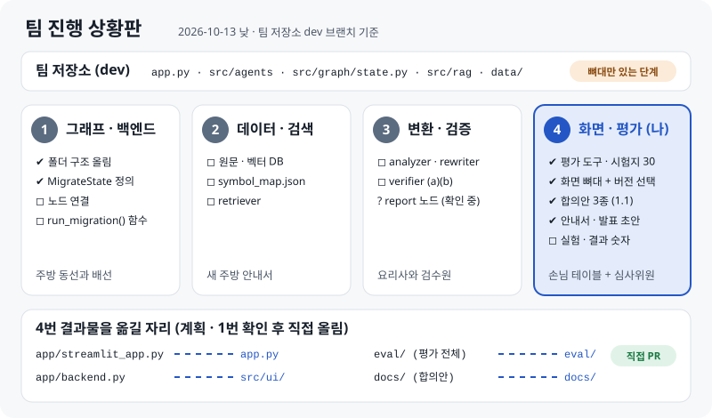
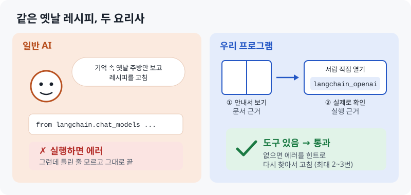

# LangChain 버전 마이그레이션 도우미

> 구버전 LangChain 코드를 최신 버전(1.x)으로 바꿔 주고, **바꾼 코드가 실제로 동작하는지까지 확인하는** 코드 마이그레이션 챗봇

**문서 근거**(공식 마이그레이션 가이드 · 릴리스 노트 검색)와 **실행 근거**(최신 환경에서 import · 속성 검증)로 이중 검증합니다.
검증에 실패하면 에러 종류와 대상을 피드백으로 다시 검색해서 고칩니다.

**바로 가기**: [발표 자료](https://skn35shimsungwook.github.io/langchain-migration-helper/presentation/발표자료.html) · [쉬운 안내서](docs/guide_v2/01_프로젝트_한눈에.md) · [**팀 진행 상황**](docs/guide_v2/03_팀_진행상황.md) · [**처음부터 다시 보기**](docs/guide_v2/05_처음부터_다시_보기.md) · [역할 분담표](docs/역할분담표.md) · 팀 합의안([출력 모양](docs/출력모양_합의안.md) · [API](docs/API_합의안.md) · [symbol_map](docs/symbol_map_합의안.md)) · [평가 규칙](eval/EVAL_RULES.md) · [작업 기록](docs/작업기록.md) · [안내서 모음 웹페이지](https://skn35shimsungwook.github.io/langchain-migration-helper/)

| | |
|---|---|
| 과제 주제 | LLM을 연동한 내외부 문서 기반 질의응답 시스템 |
| 팀 | [팀 이름] (SKN35) |
| 기간 | [시작일] ~ [발표일] |
| 팀 저장소 | [SKN35-3rd-4Team](https://github.com/SKNETWORKS-FAMILY-AICAMP/SKN35-3rd-4Team) (제출용 코드) · 이 저장소는 4번 작업장 · 기록 · 문서 |

## 진행 상황 (2026-10-13 오후 기준)

| 구분 | 내용 | 상태 |
|---|---|---|
| 역할 분담 | 1 그래프·백엔드 / 2 데이터·검색 / 3 변환·검증 / 4 화면·평가 ([역할분담표](docs/역할분담표.md)) | ✅ 확정 |
| 평가 설계 | 평가 기준과 실험 규칙 ([EVAL_RULES.md](eval/EVAL_RULES.md)), 팀 verifier와 같은 판정 기준 | ✅ 완료 |
| 테스트셋 | 구버전 코드 30개, 최신 환경에서 깨지는 것 확인 ([testset.json](eval/testset.json)) | ✅ 완료 |
| 평가 도구 | 판정기(import · 속성), 일반 AI 실험(A), 우리 시스템 실험(B), 그래프, 검사기 2종(report · symbol_map) | ✅ 완료 (API 없이 흐름 확인) |
| 화면 | 목표 버전 선택, 변환하기 탭, 성능 비교 탭 ([app/](app/)) | 🟡 뼈대 완성, 팀 그래프 함수 · API 연결 준비 완료 |
| 팀 합의안 | [출력 모양](docs/출력모양_합의안.md)(3번) · [API](docs/API_합의안.md)(1번) · [symbol_map](docs/symbol_map_합의안.md)(2번) | 🟡 1.1 (팀 저장소 코드에 맞춤), 회의에서 공유 |
| 안내서 v2 | 프로젝트 한눈에 / 화면·평가 파트 / **팀 진행 상황** (MD · PDF · 웹) | ✅ 완료 |
| 발표 자료 | 14장 초안 (그림 중심) | 🟡 초안 (결과 숫자 미입력) |
| 챗봇 본체 | 팀 저장소 dev: 폴더 구조와 `MigrateState`까지 (1~3번) | ⏳ 뼈대 단계 |
| 실험 | 일반 AI vs 우리 시스템 30문제 비교 | ⏳ 챗봇 완성 후 |

> **이 저장소의 코드와 문서는 4번이 프로젝트를 이해하려고 혼자 연습한 초안입니다.** 실제 프로젝트에서는 1번 · 2번이 뼈대와 데이터를 만든 다음, 팀 저장소에서 화면 · 평가를 처음부터 새로 만듭니다. 쉬운 설명: [05 처음부터 다시 보기](docs/guide_v2/05_처음부터_다시_보기.md)

### 팀 진행 상황 한눈에 (역할 번호로)



- **서비스 정의 (팀 합의)**: 구버전 코드를 넣고 **목표 버전을 골라** 실행하면, 새 코드와 검증 과정이 리포트로 나오는 챗봇
- **팀 저장소**: 1번이 폴더 구조와 `MigrateState(old, new, evidence_id, kind)`를 올린 뼈대 단계. 각자 브랜치 → dev로 PR, 매일 13:40 모임
- **오늘 4번이 맞춘 것**: 화면에 목표 버전 선택, 화면이 팀 그래프를 `run_migration(code, target_version)` 함수로 바로 부르는 방식(기본안), symbol_map ↔ `MigrateState` 연결표
- **확인할 것**: report 노드 담당(3번 또는 4번), 병합 담당, 비교 모델
- 자세한 내용과 오늘 질문(report 노드 vs 보고서, 브랜치, PowerShell `&&` 에러): [03 팀 진행 상황](docs/guide_v2/03_팀_진행상황.md)

---

## 1. 문제: 버전 지체 환각



LangChain은 1.0에서 패키지가 나뉘고, 옛 체인과 에이전트(`LLMChain`, `initialize_agent` 등)가 빠졌습니다.
그런데 인터넷에 쌓인 코드는 대부분 구버전이라, LLM은 복잡한 질문일수록 구버전 코드를 답합니다.

```text
# LangChain 1.4.4에서 실행한 결과
from langchain.chat_models import ChatOpenAI   → ImportError: cannot import name 'ChatOpenAI'
from langchain.chains import LLMChain          → ModuleNotFoundError: No module named 'langchain.chains'
```

더 큰 문제는 **LLM이 자기 답이 틀렸다는 것을 모른다**는 점입니다.
연구에서도 문서가 부족하면 LLM 코드의 42.55%만, 구조화된 문서를 줘도 66.36%만 목표 환경에서 실행된다고 보고합니다. ([When LLMs Lag Behind, 2026](https://arxiv.org/abs/2604.09515))

## 2. 해결: 이중 검증



| 구분 | 일반 LLM | 우리 시스템 |
|---|---|---|
| 근거 | 학습 데이터 (구버전이 다수) | 공식 가이드 · 릴리스 노트 (Qdrant, symbol_map) |
| 확인 | 없음 | 근거 ID 확인 + 샌드박스 import · 속성 검증 |
| 틀렸을 때 | 모름 | 에러 종류 · 대상을 피드백으로 재검색 후 재작성 (최대 2~3회) |
| 답변 | 코드만 | 코드 + 변경표(구 → 신, 근거 링크, 검증 결과) + 시도 횟수 |

## 3. 시스템 구조



**오프라인 (한 번, 2번)**: 마이그레이션 가이드 · 릴리스 노트 수집 → 섹션 · before/after 코드 단위 청킹 → 임베딩 → Qdrant 저장, `symbol_map.json`(구 심볼 → 신 심볼, 근거 ID) 생성

**온라인 (요청마다)**

| 단계 | 하는 일 | 담당 |
|---|---|---|
| ① analyzer | ast로 import · 클래스 · 함수 심볼 추출 | 3번 |
| ② retriever | `symbol_map` 정확 조회 + Qdrant 검색 (에러 피드백 반영) | 2번 |
| ③ rewriter | LLM이 {새 코드, 변경 목록(근거 ID 포함)} 구조화 출력 | 3번 |
| ④ verifier | (a) 근거 ID가 실제 검색 결과에 있는지 (b) 샌드박스에서 import · 속성 검증. 실패하면 에러 종류 · 대상을 피드백으로 ②로 (최대 2~3회) | 3번 |
| ⑤ report | 변환 코드 + 변경표(구 → 신, 근거 링크, 검증 결과) + 시도 횟수 | 3번 (4번 가능, 확인 중) |

단계 연결, 다시 갈지 판단, `run_migration()` 함수는 1번이 맡습니다. **화면과 평가는 파이프라인 바깥**에서 그 함수(또는 선택적으로 HTTP API)로 파이프라인을 불러 쓰며, 4번이 맡습니다.

### 팀 사이 약속

```text
2번 symbol_map · Qdrant ──같은 근거 ID──▶ 3번 report ──▶ 1번 run_migration() ──┬──▶ 4번 화면
   (symbol_map 합의안)                    (출력 모양 합의안)  (API 합의안 1.1)      └──▶ 4번 평가
```

| 합의안 | 누구와 | 핵심 |
|---|---|---|
| [출력 모양](docs/출력모양_합의안.md) | 3번 ↔ 4번 | report 모양 하나로 화면과 평가가 함께 씀. 평가 결과는 4번이 report에서 계산. 1.1에서 `target_version` 추가 |
| [API](docs/API_합의안.md) | 1번 ↔ 4번 | 기본안 `run_migration(code, target_version) → report` 함수. 선택: `POST /migrate` 등 HTTP, 검증 실패도 200 |
| [symbol_map](docs/symbol_map_합의안.md) | 2번 ↔ 3번 · 4번 | 이사 목록 모양, 근거 ID `문서#섹션-번호`, `MigrateState`(`kind: native / classic_fallback`) 연결표 |

- 파이프라인: LangGraph · LLM: [모델명] · 벡터 DB: Qdrant · 화면: Streamlit
- 근거 자료: [LangChain v1 마이그레이션 가이드](https://docs.langchain.com/oss/python/migrate/langchain-v1), 릴리스 노트

## 4. 평가 방법


같은 테스트 코드 30개를 **일반 LLM(baseline)**과 **우리 시스템**에 넣고, 같은 판정기로 성공률을 비교합니다. 자세한 규칙은 [eval/EVAL_RULES.md](eval/EVAL_RULES.md)에 있습니다.

| 난이도 | 개수 | 유형 |
|---|---|---|
| 쉬움 | 10 | import 경로만 바뀜 (chat_models, prompts, loaders 등) |
| 중간 | 10 | 체인 구조 변경 (LLMChain, RetrievalQA, 라우터 체인 등) |
| 어려움 | 10 | 에이전트 · 메모리 변경 (initialize_agent, AgentExecutor 등) |

- **성공 기준**: 문법 통과 + import 성공 + **import 한 이름의 속성이 실제로 있음** + 무효 변환 아님
- **판정 기준 통일**: 평가 판정기 `eval/verify.py`를 팀 verifier (b)의 출발점으로 넘겨, 파이프라인 검증과 평가 채점이 같은 기준을 씁니다.
- **공정성**: 같은 모델, temperature 0, 같은 입력, 같은 판정기
- **지표**: 전체 · 난이도별 성공률, 1회차 · 최종 성공률, 검증 루프 효과, 근거 일치율, 실패 원인 분포, 성공의 질(community 경고, classic 의존)

## 5. 결과

> ⏳ 실험 전입니다. 실험 후 `make_charts.py`가 만든 `eval/charts/summary.md`와 그래프 3장으로 이 부분을 채웁니다. 화면의 [성능 비교] 탭에도 같은 결과가 나타납니다.

| 시스템 | 전체 | 쉬움 | 중간 | 어려움 |
|---|---|---|---|---|
| 우리 시스템 | [__]% | [__]% | [__]% | [__]% |
| 일반 LLM (baseline) | [__]% | [__]% | [__]% | [__]% |

- 우리 시스템 1회차 성공률: [__]% → 최종 성공률: [__]%
- **검증 루프 효과: +[__]%p** · 근거 일치율: [__]%

## 6. 실험 중 발견한 것


- **`langchain-community`는 import만 해도 지원 종료 경고를 냅니다.** (2026-10-12, langchain-community 0.4.2) 지금은 통과해도 곧 깨질 수 있어 `uses_community`로 따로 집계합니다.
- **`langchain_classic`으로 우회하면 옛 체인도 import가 됩니다.** 최신 방식은 아니므로 `uses_classic`으로 따로 집계합니다.
- **에이전트도 classic으로 우회됩니다.** `langchain_classic.agents`에서 `initialize_agent`, `AgentType`, `AgentExecutor`는 import되고, `load_tools`만 `langchain-community` 의존성 문제로 실패합니다. 어려운 문제도 우회로 "통과"할 수 있으므로 classic 의존 비율이 중요합니다.
  (처음에는 여러 이름을 한 줄로 가져와 전부 실패하는 것처럼 보였고, 2026-10-13 하나씩 다시 확인해서 바로잡았습니다. [작업 기록](docs/작업기록.md)의 정정 기록 참고)

## 7. 한계와 다음 단계

| 한계 | 다음 단계 |
|---|---|
| 속성 이름까지는 확인하지만, 함수 인자나 실행 결과는 확인하지 못함 | 가짜 LLM으로 코드 전체 실행 테스트 추가 |
| 테스트 30개를 팀이 직접 구축 | 공개 저장소의 실사용 코드로 확장 |
| 구버전 환경에서 동작하는지는 확인하지 않음 | 구버전 환경을 따로 만들어 교차 확인 |
| LangChain만 대상 | pydantic, OpenAI SDK 등 다른 라이브러리로 확장 |

## 8. 실행 방법

### 8-1. 화면 (4번)

```bash
pip install -r app/requirements.txt
streamlit run app/streamlit_app.py
```

화면 맨 위에서 **목표 버전**(지금은 LangChain 1.x)을 고르고 코드를 넣습니다. 파이프라인을 부르는 방법은 세 가지이고, 위에 있는 것이 먼저입니다. 호출 규칙은 [API 합의안](docs/API_합의안.md), 응답 모양은 [출력 모양 합의안](docs/출력모양_합의안.md)에 있습니다.

| 방법 | 설정 (PowerShell) | 배지 |
|---|---|---|
| 팀 그래프 함수 (기본안) | `$env:MIGRATION_FUNC="src.graph.supervisor:run_migration"` | 초록 "팀 그래프 직접 호출" |
| HTTP API (선택) | `$env:MIGRATION_API_URL="http://localhost:8000"` | 초록 "API 연결됨" / 빨강 "API 연결 안 됨" |
| 가짜 응답 | 아무것도 넣지 않음 (테스트셋 예제만 변환) | 회색 "가짜 응답 모드" |

실제 API가 나오기 전에는 연습용 서버로 HTTP 연결을 시험할 수 있습니다: `python docs/contracts/api_stub.py"

### 8-2. 챗봇 본체

챗봇 본체는 [팀 저장소](https://github.com/SKNETWORKS-FAMILY-AICAMP/SKN35-3rd-4Team)에 있습니다 (uv, Python 3.12). Windows PowerShell 5.1은 `&&`를 지원하지 않으므로 **한 줄씩** 실행합니다.

```powershell
git clone -b dev https://github.com/SKNETWORKS-FAMILY-AICAMP/SKN35-3rd-4Team.git
cd SKN35-3rd-4Team
uv sync
```

오프라인 준비(벡터 DB 만들기)와 그래프 실행 명령은 1번 · 2번이 정하면 채웁니다.

### 8-3. 평가 재현

`eval` 폴더에서 실행합니다. 쉬운 설명은 [02 화면·평가 파트](docs/guide_v2/02_화면평가_파트.md) 4장에 있습니다.

```bash
uv venv verify-env --python 3.12
uv pip install --python verify-env/Scripts/python.exe langchain langchain-core langchain-openai langchain-community langchain-classic langgraph
verify-env/Scripts/python.exe -m pip freeze > requirements-verify.txt
python check_testset.py testset.json --py verify-env/Scripts/python.exe
python run_baseline.py --py verify-env/Scripts/python.exe --model [모델명]
python run_system.py --py verify-env/Scripts/python.exe --model [모델명]   # MIGRATION_FUNC 또는 MIGRATION_API_URL 필요
python make_charts.py --a results/A_[모델명]_[날짜].json --b results/B_[모델명]_[날짜].json

# 팀원 결과물 검사
python check_contract.py report.json --py verify-env/Scripts/python.exe          # 3번 report 모양 + 판정 일치
python check_symbol_map.py symbol_map.json --py verify-env/Scripts/python.exe --testset testset.json   # 2번 symbol_map
```

OpenAI API 키는 환경 변수 `OPENAI_API_KEY`로 설정합니다. `run_baseline.py`와 `run_system.py`는 `--limit 3`(3문제 먼저), `--mock`(API 없이 흐름만 확인)을 지원하고, 중간에 멈춰도 이어서 실행됩니다. `run_system.py`는 HTTP API의 모델이 `--model`과 다르면 경고하고, 함수 호출일 때는 모델을 직접 확인하라고 알려 줍니다.

## 9. 폴더 구조

**팀 저장소에 올릴 사본**: [for_team_repo/](for_team_repo/)는 팀 저장소와 **같은 폴더 구조**로 4번 파일만 모은 사본입니다(`app.py`, `src/ui/`, `eval/`, `docs/`). 팀 저장소에 그대로 덮어 복사하면 되고, 바뀌는 기존 파일은 `app.py` 하나입니다. 원본(`app/`, `eval/`, `docs/`)을 고친 뒤에는 `python tools/make_team_copy.py`로 사본을 다시 만듭니다. 올리는 순서는 [4번_화면평가_올리는법.md](for_team_repo/docs/4번_화면평가_올리는법.md)에 있습니다.

```text
langchain_migration/
├── README.md
├── index.html                 # GitHub Pages 목차 페이지
├── for_team_repo/             # 팀 저장소와 같은 구조의 4번 파일 사본 (tools/make_team_copy.py가 만듦, 직접 고치지 않음)
├── tools/                     # make_team_copy.py: 원본 → for_team_repo/ 사본 만들기
│                              # 챗봇 본체(src/, data/)는 팀 저장소에 있음
├── app/                       # 화면 (4번)
│   ├── streamlit_app.py       # 변환하기 · 성능 비교 탭
│   └── backend.py             # 팀 그래프 함수 · API 호출 / 가짜 응답, 목표 버전
├── eval/                      # 평가 (4번)
│   ├── EVAL_RULES.md          # 평가 기준과 실험 규칙
│   ├── testset.json           # 테스트 코드 30개
│   ├── check_testset.py       # 테스트 코드가 최신 환경에서 깨지는지 확인
│   ├── verify.py              # 공용 판정기 (import · 속성), 팀 verifier (b)의 출발점
│   ├── run_baseline.py        # baseline(일반 LLM) 실험
│   ├── run_system.py          # 우리 시스템 실험 (report → 평가 결과)
│   ├── check_contract.py      # report가 합의한 모양인지 검사
│   ├── check_symbol_map.py    # symbol_map이 맞는지 실행으로 확인, 테스트셋 대조
│   └── make_charts.py         # 결과 그래프와 요약표
├── presentation/              # 발표 자료 (원본, 웹 버전, PDF)
└── docs/
    ├── guide_v2/              # 쉬운 안내서 최신: 01 한눈에, 02 화면·평가, 03 팀 진행 상황, 05 처음부터 다시 보기, 04(이전 버전) (MD · PDF · HTML)
    ├── images/                # 설명 그림 (움직이는 SVG, static/은 슬라이드용 정지 그림)
    ├── 역할분담표.md
    ├── 출력모양_합의안.md      # 3번 report 모양 (contracts/ 에 예시 JSON)
    ├── API_합의안.md           # 1번 API 규칙 (contracts/api_stub.py 연습용 서버)
    ├── symbol_map_합의안.md    # 2번 이사 목록 · 근거 ID 규칙
    ├── contracts/             # 예시 JSON (report 2개, symbol_map), 연습용 API 서버
    ├── 작업기록.md
    ├── 데이터_출처_조사.md
    ├── guide/                 # 안내서 이전 버전 v1
    └── 역순설계_쉽게_이해하기.md  # 이전 버전 (초판)
```

## 10. 문서 모음

| 문서 | 내용 | 보기 |
|---|---|---|
| **발표 자료** (초안) | 14장, 웹에서는 그림이 움직이고 발표자 노트 포함 | [웹](https://skn35shimsungwook.github.io/langchain-migration-helper/presentation/발표자료.html) · [PDF](presentation/발표자료.pdf) |
| **01 프로젝트 한눈에** (최신 v2.1) | 주방 비유, 새 설계(기본 설계), 역할, 용어 사전 (팀 모두용) | [MD](docs/guide_v2/01_프로젝트_한눈에.md) · [PDF](docs/guide_v2/01_프로젝트_한눈에.pdf) · [웹](https://skn35shimsungwook.github.io/langchain-migration-helper/docs/guide_v2/01_프로젝트_한눈에.html) |
| **02 화면·평가 파트** (최신 v2.1) | 역설계, 평가, 화면, 따라 하기, 결과 읽기, 맞출 것, 발표 질문, 체크리스트 | [MD](docs/guide_v2/02_화면평가_파트.md) · [PDF](docs/guide_v2/02_화면평가_파트.pdf) · [웹](https://skn35shimsungwook.github.io/langchain-migration-helper/docs/guide_v2/02_화면평가_파트.html) |
| **03 팀 진행 상황** (최신) | 팀 저장소 상태, 팀 대화 정리(역할 번호), 내 역할, 오늘 질문, 회의 안건 | [MD](docs/guide_v2/03_팀_진행상황.md) · [PDF](docs/guide_v2/03_팀_진행상황.pdf) · [웹](https://skn35shimsungwook.github.io/langchain-migration-helper/docs/guide_v2/03_팀_진행상황.html) |
| **05 처음부터 다시 보기** (최신) | 프로젝트가 무엇인지, 챗봇 · 팀의 일 순서(이어달리기), 4번이 언제 무엇을 하는지, 팀에게 말하는 법 | [MD](docs/guide_v2/05_처음부터_다시_보기.md) · [PDF](docs/guide_v2/05_처음부터_다시_보기.pdf) · [웹](https://skn35shimsungwook.github.io/langchain-migration-helper/docs/guide_v2/05_처음부터_다시_보기.html) |
| 04 팀 보고 준비 (이전 버전) | 4번이 만든 것(팀이 바로 쓸 수 있는 순서), 팀 저장소에서 할 일 순서, 회의 1분 대본, 공지 · 1:1 메시지 · PR 설명 | [MD](docs/guide_v2/04_팀_보고_준비.md) · [PDF](docs/guide_v2/04_팀_보고_준비.pdf) · [웹](https://skn35shimsungwook.github.io/langchain-migration-helper/docs/guide_v2/04_팀_보고_준비.html) |
| **역할 분담표** | 네 역할, 1번과 3번의 경계, 서로 맞춰야 하는 것, 팀 저장소에 넣을 자리 | [MD](docs/역할분담표.md) |
| **출력 모양 합의안** | 3번 report 모양 (화면과 평가가 함께 씀), 예시 JSON, 검사 방법 | [MD](docs/출력모양_합의안.md) |
| **API 합의안** | 1번 그래프 호출: 기본 함수 `run_migration()`, 선택 HTTP 주소 3개, 에러 규칙, 연습용 서버 | [MD](docs/API_합의안.md) |
| **symbol_map 합의안** | 2번 이사 목록 모양, 근거 ID 규칙, Qdrant payload, 테스트셋 대조 | [MD](docs/symbol_map_합의안.md) |
| 평가 기준과 실험 규칙 | 성공 기준, 지표, 실험 조건, 결과 형식 | [MD](eval/EVAL_RULES.md) |
| 작업 기록 | 지금 기준(역할 · 약속 · 주요 결정 · 정정), 날짜별 기록, 남은 일 | [MD](docs/작업기록.md) |
| 데이터 출처 조사 | RAG 문서와 테스트 코드 출처 | [MD](docs/데이터_출처_조사.md) |
| 이전 버전 | 안내서 v1(역할 변경 전), 역순 설계 초판 | [guide/](docs/guide/) · [역순설계](docs/역순설계_쉽게_이해하기.md) |

## 11. 팀

공개 저장소라서 팀원은 **역할 번호로만** 적습니다.

| 역할 | 담당 |
|---|---|
| 1번 | 그래프 · 백엔드 (State, LangGraph 연결, 재시도 조건, `run_migration()`, 샌드박스 환경) |
| 2번 | 데이터 · 검색 (문서 수집, 청킹, Qdrant, symbol_map, retriever) |
| 3번 | 변환 · 검증 (analyzer, rewriter, verifier, report 노드는 확인 중) |
| 4번 | 화면 · 평가 (Streamlit 화면, 실험 설계, 테스트셋, 비교 실험) + 보고서, README, 발표 · 이 저장소 |

## 12. 참고 자료

- [LangChain v1 마이그레이션 가이드](https://docs.langchain.com/oss/python/migrate/langchain-v1)
- [LangChain 공식 문서 llms-full.txt](https://docs.langchain.com/llms-full.txt)
- Ashik et al., [When LLMs Lag Behind: Knowledge Conflicts from Evolving APIs in Code Generation](https://arxiv.org/abs/2604.09515), 2026
- [GitChameleon 2.0: Evaluating AI Code Generation Against Python Library Version Incompatibilities](https://arxiv.org/abs/2507.12367), 2025
- Wu et al., [VersiCode: Towards Version-controllable Code Generation](https://arxiv.org/abs/2406.07411), 2024
