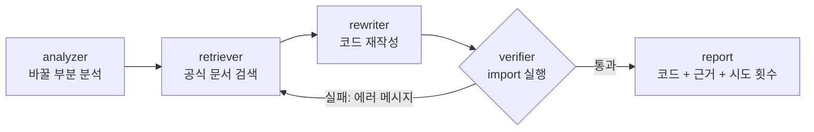

# LangChain 버전 마이그레이션 도우미

> 구버전 LangChain 코드를 최신 버전(1.x)으로 바꿔 주고, **바꾼 코드가 실제로 동작하는지까지 확인하는** 코드 마이그레이션 챗봇

**문서 근거**(최신 공식 문서 검색)와 **실행 근거**(최신 환경에서 import 실행)로 이중 검증합니다.
검증에 실패하면 에러 메시지로 다시 검색해서 고칩니다.

| | |
|---|---|
| 과제 주제 | LLM을 연동한 내외부 문서 기반 질의응답 시스템 |
| 팀 | [팀 이름] (SKN35) |
| 기간 | [시작일] ~ [발표일] |
| 발표 자료 | [발표 자료 링크] |

**처음 보는 분께**: [거꾸로 생각하면 쉬워요: 역순 설계로 보는 우리 프로젝트](docs/역순설계_쉽게_이해하기.md)를 먼저 읽어 보세요. 초등학생도 이해할 수 있게 설명했습니다.

| 문서 | 내용 |
|---|---|
| [docs/역순설계_쉽게_이해하기.md](docs/역순설계_쉽게_이해하기.md) | 발표 장면부터 거꾸로 따라가며 보는 프로젝트 설명 |
| [docs/작업기록.md](docs/작업기록.md) | 무엇을 왜 했는지, 확인한 결과와 남은 일 |
| [docs/데이터_출처_조사.md](docs/데이터_출처_조사.md) | RAG 문서와 테스트 코드 출처 조사 |
| [eval/EVAL_RULES.md](eval/EVAL_RULES.md) | 평가 기준과 실험 규칙 |

---

## 1. 문제: 버전 지체 환각

LangChain은 1.0에서 패키지가 나뉘고, 옛 체인과 에이전트(`LLMChain`, `initialize_agent` 등)가 빠졌습니다.
그런데 인터넷에 쌓인 코드는 대부분 구버전이라, LLM은 복잡한 질문일수록 구버전 코드를 답합니다.

```python
# LLM이 흔히 주는 코드
from langchain.chat_models import ChatOpenAI
from langchain.chains import LLMChain
```

```text
# LangChain 1.4.4에서 실행한 결과
ImportError: cannot import name 'ChatOpenAI' from 'langchain.chat_models'
ModuleNotFoundError: No module named 'langchain.chains'
```

더 큰 문제는 **LLM이 자기 답이 틀렸다는 것을 모른다**는 점입니다.
연구에서도 문서가 부족하면 LLM 코드의 42.55%만, 구조화된 문서를 줘도 66.36%만 목표 환경에서 실행된다고 보고합니다. ([When LLMs Lag Behind, 2026](https://arxiv.org/abs/2604.09515))

## 2. 해결: 이중 검증

| 구분 | 일반 LLM | 우리 시스템 |
|---|---|---|
| 근거 | 학습 데이터 (구버전이 다수) | 최신 공식 문서 검색 (RAG) |
| 확인 | 없음 | 최신 환경에서 import 실제 실행 |
| 틀렸을 때 | 모름 | 에러 메시지로 다시 검색 후 재작성 |
| 답변 | 코드만 | 코드 + 근거 링크 + 시도 횟수 |

## 3. 시스템 구조



| 단계 | 하는 일 | 담당 |
|---|---|---|
| analyzer | 입력 코드에서 바꿔야 할 부분과 이유를 찾음 | 3번 |
| retriever | 최신 공식 문서 검색 (벡터DB + 필요 시 웹 검색) | 2번 |
| rewriter | 검색된 문서를 근거로 코드 재작성 | 3번 |
| verifier | 최신 LangChain 환경에서 import 실행, 실패하면 retriever로 회귀 (최대 3회) | 1번 |
| report | 검증된 코드, 근거 문서, 시도 횟수로 답변 생성 | 3번 |

- 파이프라인: [LangGraph]
- LLM: [모델명]
- 벡터DB: [Chroma / FAISS]
- 화면: [Streamlit]
- 검색 원천: [LangChain 공식 문서](https://docs.langchain.com) (`llms-full.txt`, [v1 마이그레이션 가이드](https://docs.langchain.com/oss/python/migrate/langchain-v1))

## 4. 폴더 구조

```text
langchain_migration/
├── README.md
├── [app/]                 # 화면 (3번)
├── [graph/]               # LangGraph 파이프라인, 백엔드 (1번)
├── [data/]                # 문서 수집, 벡터DB (2번)
└── eval/                  # 평가 (4번)
    ├── EVAL_RULES.md      # 평가 기준과 실험 규칙
    ├── testset.json       # 테스트 코드 30개 (쉬움/중간/어려움 각 10개)
    ├── check_testset.py   # 테스트 코드가 최신 환경에서 깨지는지 확인
    ├── verify.py          # 공용 판정 모듈 (A, B 모두 이것으로 판정)
    ├── run_baseline.py    # baseline(일반 LLM) 실험
    ├── make_charts.py     # 결과 그래프와 요약표 생성
    ├── results/           # 실험 결과 JSON
    └── charts/            # 결과 그래프 PNG
```

## 5. 실행 방법

### 5-1. 챗봇 실행

```bash
[1번 팀원 확인 후 작성: 설치 및 실행 명령]
```

### 5-2. 평가 재현

`eval` 폴더에서 실행합니다.

**① 검증 환경 만들기 (처음 한 번)**

```bash
uv venv verify-env --python 3.12
uv pip install --python verify-env/Scripts/python.exe langchain langchain-core langchain-openai langchain-community langchain-classic langgraph
verify-env/Scripts/python.exe -m pip freeze > requirements-verify.txt
```

**② 테스트셋 확인**

```bash
python check_testset.py testset.json --py verify-env/Scripts/python.exe
```

**③ baseline(일반 LLM) 실험**

```bash
pip install openai matplotlib
python run_baseline.py --py verify-env/Scripts/python.exe --model [모델명]
```

OpenAI API 키는 환경 변수 `OPENAI_API_KEY`로 설정합니다.

**④ 우리 시스템 실험**

```bash
[1번 팀원 확인 후 작성: B 실행 명령. 결과는 verify.py로 판정하고 results/B_*.json에 저장]
```

**⑤ 그래프 만들기**

```bash
python make_charts.py --a results/A_[모델명]_[날짜].json --b results/B_[모델명]_[날짜].json
```

## 6. 평가 방법

자세한 규칙은 [eval/EVAL_RULES.md](eval/EVAL_RULES.md)에 있습니다.

- **테스트셋**: 구버전 LangChain 코드 30개. 30개 모두 최신 환경(langchain 1.4.4)에서 깨지는 것을 확인했습니다.

| 난이도 | 개수 | 유형 |
|---|---|---|
| 쉬움 | 10 | import 경로만 바뀜 (chat_models, prompts, loaders 등) |
| 중간 | 10 | 체인 구조 변경 (LLMChain, RetrievalQA, 라우터 체인 등) |
| 어려움 | 10 | 에이전트·메모리 변경 (initialize_agent, AgentExecutor 등) |

- **성공 기준**: 문법 통과 + 모든 import 성공 + 무효 변환 아님 (LangChain import를 지워서 통과하는 경우 등은 실패)
- **공정성**: 일반 LLM과 우리 시스템은 같은 모델, temperature 0, 같은 입력, 같은 판정기(`verify.py`)를 사용합니다.
- **검증 환경**: [requirements-verify.txt](eval/requirements-verify.txt)로 버전 고정

## 7. 결과

> 실험 후 `make_charts.py`가 만든 `charts/summary.md` 내용으로 교체합니다.

| 시스템 | 전체 | 쉬움 | 중간 | 어려움 |
|---|---|---|---|---|
| 우리 시스템 | [__]% | [__]% | [__]% | [__]% |
| 일반 LLM (baseline) | [__]% | [__]% | [__]% | [__]% |

- 우리 시스템 1회차 성공률: [__]% → 최종 성공률: [__]%
- **검증 루프 효과: +[__]%p**


## 8. 실험 중 발견한 것

- **`langchain-community`는 import만 해도 지원 종료 경고를 냅니다.**
  `DeprecationWarning: langchain-community is being sunset and is no longer actively maintained` (2026-10-12, langchain-community 0.4.2 기준).
  지금은 통과해도 곧 깨질 수 있는 코드이므로 `uses_community`로 따로 집계했습니다.
- **`langchain_classic`으로 우회하면 옛 체인도 import가 됩니다.**
  `from langchain_classic.chains import LLMChain`은 통과하지만 최신 방식으로 바꾼 것은 아니므로 `uses_classic`으로 따로 집계했습니다.
- 반면 `langchain_classic.agents`의 `initialize_agent`, `load_tools`는 의존성 문제로 import에 실패했습니다. 어려움 문제는 우회도 잘 되지 않습니다.

## 9. 한계와 다음 단계

| 한계 | 다음 단계 |
|---|---|
| import는 되지만 메서드나 인자가 틀릴 수 있음 | 가짜 LLM으로 코드 전체 실행 테스트 추가 |
| 테스트 30개를 팀이 직접 구축 | 공개 저장소의 실사용 코드로 확장 |
| 구버전 환경에서 동작하는지는 확인하지 않음 | 구버전 환경을 따로 만들어 교차 확인 |
| LangChain만 대상 | pydantic, OpenAI SDK 등 다른 라이브러리로 확장 |

## 10. 팀

| 역할 | 담당 | 이름 |
|---|---|---|
| 1번 | 그래프 · 백엔드 (LangGraph 파이프라인, API, verifier) | [이름] |
| 2번 | 데이터 · 검색 (문서 수집, 벡터DB, retriever) | [이름] |
| 3번 | 변환 · 화면 (analyzer, rewriter, report, Streamlit) | [이름] |
| 4번 | 검증 · 평가 (실험 설계, 테스트셋, 비교 실험), README, 발표 | [이름] |

## 11. 참고 자료

- [LangChain v1 마이그레이션 가이드](https://docs.langchain.com/oss/python/migrate/langchain-v1)
- [LangChain 공식 문서 llms-full.txt](https://docs.langchain.com/llms-full.txt)
- Ashik et al., [When LLMs Lag Behind: Knowledge Conflicts from Evolving APIs in Code Generation](https://arxiv.org/abs/2604.09515), 2026
- [GitChameleon 2.0: Evaluating AI Code Generation Against Python Library Version Incompatibilities](https://arxiv.org/abs/2507.12367), 2025
- Wu et al., [VersiCode: Towards Version-controllable Code Generation](https://arxiv.org/abs/2406.07411), 2024
