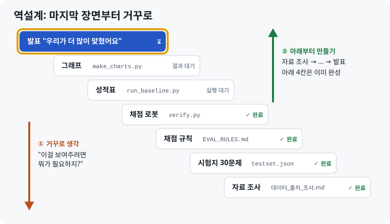

# 프로젝트 전체 쉽게 보기

> **최신 버전 · 2026-10-12**  
> 웹에서 보기(퀴즈 포함): [HTML](https://skn35shimsungwook.github.io/langchain-migration-helper/docs/guide/01_프로젝트_전체_쉽게_보기.html) · 인쇄용: [PDF](01_프로젝트_전체_쉽게_보기.pdf)  
> 다음 문서: [02 검증·평가 파트 상세](02_검증평가_파트_상세.md) (4번 담당의 할 일)  
> 이전 버전: [역순설계_쉽게_이해하기.md](../역순설계_쉽게_이해하기.md)

## 이것 세 줄만 기억해도 됩니다

1. AI는 **옛날 주방**만 기억해서, 도구가 이사 간 줄 모르고 옛날 레시피를 줍니다.
2. 우리 프로그램은 **새 주방 안내서를 보고** 레시피를 고친 뒤, **서랍을 직접 열어 보며** 도구가 있는지 확인합니다.
3. 나(4번)는 **요리 대회 심사위원**입니다. 같은 문제 30개로 "우리가 더 잘 고친다"를 숫자로 증명합니다.

---

---

## 1장. 프로젝트 전체를 주방으로 이해하기

| 코드 세계 | 주방 세계 |
|---|---|
| LangChain | AI 프로그램을 만드는 **주방 도구 세트** |
| 코드 | **레시피** |
| `import` | "어느 **서랍**에서 어떤 **도구**를 꺼내라" |
| 패키지 (`langchain_openai` 등) | **서랍장** 하나 |
| LangChain 1.0 업데이트 | 주방을 **새로 정리**함. 도구가 다른 서랍으로 이사 감 |
| ImportError | "그 서랍에 그런 도구 없어요" |
| ModuleNotFoundError | "그런 서랍 자체가 없어요" |

```python
from langchain.chat_models import ChatOpenAI
# = "langchain 서랍장의 chat_models 칸에서 ChatOpenAI 도구를 꺼내라"
```


최신 LangChain(1.4.4)에서 옛날 서랍을 열면 실제로 이렇게 됩니다.

```text
from langchain.chat_models import ChatOpenAI
ImportError: cannot import name 'ChatOpenAI'              ← "그 칸에 그런 도구 없어요"

from langchain.chains import LLMChain
ModuleNotFoundError: No module named 'langchain.chains'   ← "그런 칸 자체가 없어요"
```


**이중 검증** = ① 안내서 보기(문서 근거) + ② 서랍 직접 열기(실행 근거)

> **헷갈리기 쉬운 점**: 우리 프로그램은 **주방을 정리하지 않습니다.** 새 주방은 LangChain 회사가 이미 정리해 두었습니다. 우리가 고치는 것은 **레시피(사용자의 코드)**입니다. "옛날 서랍 A에서 꺼내라"를 "새 서랍 B에서 꺼내라"로 고쳐 쓰고, B를 열어 보며 도구가 진짜 있는지 확인합니다.

## 2장. 기본 설계: 프로그램은 어떤 순서로 일하나 (앞 → 뒤)


레시피 카드가 ④ 서랍 열기에서 막히면 ②로 돌아가 다시 찾습니다. 이 되돌아가는 길이 **검증 루프**입니다.

## 3장. 역설계: 발표 장면에서 거꾸로 (뒤 → 앞)



| | 기본 설계 (2장) | 역설계 (3장) |
|---|---|---|
| 방향 | 앞 → 뒤 | 뒤 → 앞 |
| 보는 것 | **프로그램**이 일하는 순서 | **내(4번)**가 일하는 순서 |
| 질문 | "코드를 넣으면 무슨 일이 일어나지?" | "발표에서 보여주려면 뭐가 필요하지?" |

실제로 일하는 순서는 계단을 아래에서 위로(1 → 6) 올라가는 순서입니다. 1~4번은 초안이 완성되어 있습니다.

## 4장. 용어 사전

| 용어 | 쉬운 뜻 |
|---|---|
| 마이그레이션 | 옛날 레시피를 새 주방에 맞게 고치는 일 |
| 버전 지체 환각 | AI가 옛날 주방만 기억해서 틀린 위치를 자신 있게 알려 주는 현상 |
| RAG | AI가 답하기 전에 안내서(문서)를 찾아보게 하는 방법 |
| 가상환경 (verify-env) | 시험용으로 따로 만든 깨끗한 새 주방 |
| 검증 / verifier | 서랍을 직접 열어 보고 도구가 있는지 확인하는 단계 |
| 검증 루프 | 도구가 없으면 안내서를 다시 찾아 고치는 되돌아가는 길 |
| baseline | 비교 기준. 여기서는 일반 AI의 성적 |
| 테스트셋 | 시험 문제지. 옛날 레시피 30개 |
| langchain_classic | 옛날 도구를 모아 둔 창고 |
| langchain_community | "곧 문 닫습니다" 공지가 붙은 가게 |
| JSON | 컴퓨터가 읽기 쉽게 정리한 표 같은 파일 |

## 5장. 확인 퀴즈

<details><summary>Q1. 옛날 코드 <code>from langchain.chat_models import ChatOpenAI</code>를 최신 LangChain에서 실행하면?</summary>에러가 납니다. ChatOpenAI가 <code>langchain_openai</code> 서랍으로 이사 갔기 때문입니다.</details>

<details><summary>Q2. 우리 프로그램이 일반 AI와 다른 두 가지 근거는?</summary>문서 근거(안내서를 보고 고침) + 실행 근거(서랍을 직접 열어 확인)</details>

<details><summary>Q3. verifier에서 도구가 없다고 나오면?</summary>에러 메시지를 들고 retriever로 돌아가 다시 찾습니다. 최대 3번.</details>
