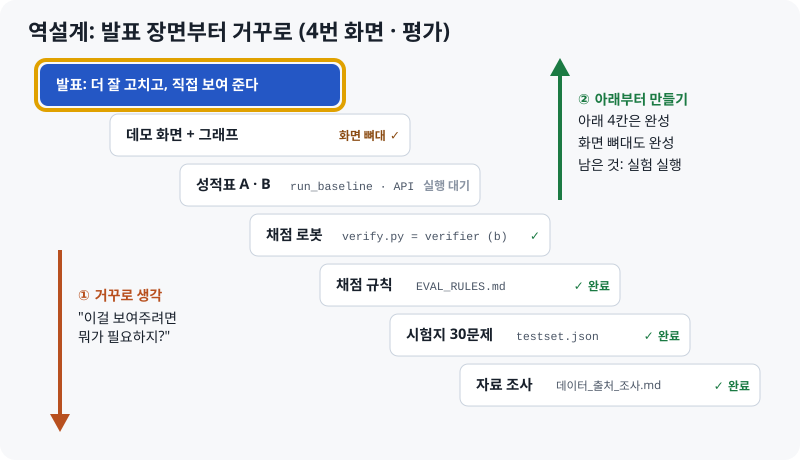
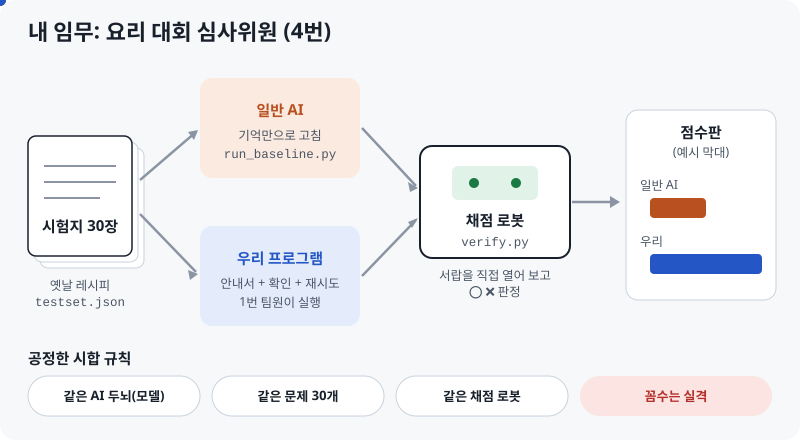
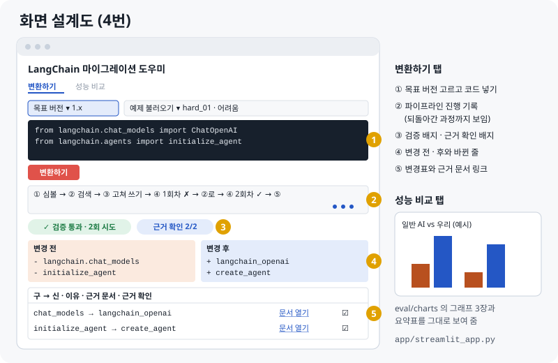
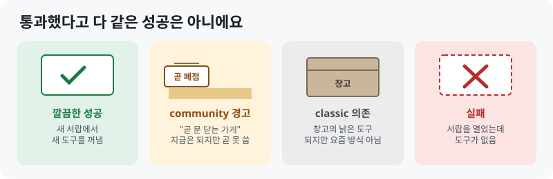

# 화면·평가 파트

> **최신 버전 v2 · 2026-10-12** — 4번(화면 · 평가) 담당 안내서
> 웹에서 보기(퀴즈 · 체크리스트 포함): [HTML](https://skn35shimsungwook.github.io/langchain-migration-helper/docs/guide_v2/02_화면평가_파트.html) · 인쇄용: [PDF](02_화면평가_파트.pdf)
> 먼저 읽을 문서: [01 프로젝트 한눈에](01_프로젝트_한눈에.md)
> 이전 버전: [docs/guide/](../guide/)

## 이것 세 줄만 기억해도 됩니다

1. 나는 **손님 테이블**(결과를 보여 주는 화면)과 **심사위원**(효과를 숫자로 증명하는 평가)입니다.
2. 평가는 **같은 문제 30개, 같은 채점 로봇**으로 일반 AI와 우리 프로그램을 공정하게 비교합니다.
3. 화면은 **결과, 바뀐 줄, 근거 링크, 검증 배지**를 한눈에 보여 주고, 발표 데모도 이 화면으로 합니다.

보고서, README, 발표도 4번이 맡습니다.

---

## 1장. 역설계: 발표 장면에서 거꾸로

01 문서의 기본 설계는 **프로그램**이 일하는 순서였습니다. 역설계는 **내가** 일하는 순서를 정하는 방법입니다.



아래 다섯 칸(자료 조사, 시험지, 채점 규칙, 채점 로봇, 화면 뼈대)은 이미 만들었습니다. **남은 것은 실험을 실행하고 결과를 화면과 발표에 채우는 일**입니다.

## 2장. 평가: 요리 대회 심사위원



| 파일 | 주방 비유 | 할 일 |
|---|---|---|
| [`EVAL_RULES.md`](../../eval/EVAL_RULES.md) | 시합 규칙표 | 팀과 빈칸 채우기 (비교 모델, 최대 시도 2 또는 3회) |
| [`testset.json`](../../eval/testset.json) | 시험지 30장 | 쉬움 · 중간 · 어려움 하나씩 왜 깨지는지 말로 설명해 보기 |
| [`check_testset.py`](../../eval/check_testset.py) | 시험지 검사기 | 실행해서 "통과 30/30" 보기 |
| [`verify.py`](../../eval/verify.py) | 채점 로봇 | 3번에게 넘겨 verifier (b)의 출발점으로 쓰게 하기 |
| [`run_baseline.py`](../../eval/run_baseline.py) | 상대 선수 시험 기계 | 일반 AI 30문제 실행 |
| [`run_system.py`](../../eval/run_system.py) | 우리 선수 시험 기계 | 30문제를 API로 돌리고 report를 평가 결과로 바꾸기 |
| [`check_contract.py`](../../eval/check_contract.py) | 접시 모양 검사기 | 3번 report가 약속한 모양인지 확인 |
| [`make_charts.py`](../../eval/make_charts.py) | 점수판 그리기 | 그래프 3장과 요약표 만들기 |

> **채점 로봇이 보는 것**: ① 문법 ② 서랍에서 도구를 꺼낼 수 있는가(import) ③ **그 도구의 기능 이름이 진짜 있는가**(속성, 예: `PromptTemplate.from_template`) ④ 어려운 부분을 지워서 통과한 꼼수는 아닌가. ③은 팀 verifier (b)와 같은 기준이라, 없는 기능을 지어낸 코드도 잡습니다.

**왜 AI에게 "맞아?"라고 묻지 않나요?** 채점하는 AI도 옛날 주방만 기억하면 틀린 레시피에 합격을 줄 수 있습니다. 그래서 서랍을 직접 열어서 채점합니다.

## 3장. 화면: 손님 테이블



뼈대는 [`app/streamlit_app.py`](../../app/streamlit_app.py)에 있습니다. 지금은 테스트셋으로 만든 **가짜 응답**으로 돌아가고, 1번의 API 주소를 `MIGRATION_API_URL`에 넣으면 실제 결과를 보여 줍니다.

| report가 보내 줄 것 (3번과 약속) | 화면에서 보이는 곳 |
|---|---|
| `migrated_code` 고친 코드 | ④ 변경 후, 바뀐 줄 |
| `changes` 구 → 신, 이유, 근거 링크, 근거 확인 | ⑤ 변경표, 근거 확인 배지 |
| `verification` 통과 여부, 실패 단계 | ③ 검증 배지 |
| `attempts`, `attempt_log` 시도 횟수와 실패 이유 | ② 진행 기록, ③ "2회 시도" |

정확한 모양은 [`app/backend.py`](../../app/backend.py) 맨 위에 적어 두었습니다.

## 4장. 따라 하기

```powershell
# 0. 평가 폴더로
cd "C:\Users\playdata2\Desktop\skn35 report\langchain_migration\eval"

# 1. 시험용 새 주방 만들기 (처음 한 번)
uv venv verify-env --python 3.12
uv pip install --python verify-env/Scripts/python.exe langchain langchain-core langchain-openai langchain-community langchain-classic langgraph
verify-env/Scripts/python.exe -m pip freeze > requirements-verify.txt

# 2. 시험지 검사 → "통과: 30 / 30"
python check_testset.py testset.json --py verify-env/Scripts/python.exe

# 3. 일반 AI 시험 (--mock 은 API 없이 흐름만 확인)
$env:OPENAI_API_KEY="sk-...내 키..."
python run_baseline.py --py verify-env/Scripts/python.exe --model [모델명] --limit 3

# 4. 화면 켜기
streamlit run ../app/streamlit_app.py

# 5. 점수판 그리기 (결과가 나온 뒤)
python make_charts.py --a results/A_[모델]_[날짜].json --b results/B_[모델]_[날짜].json
```

**막히면 Claude에게**: "eval 폴더에서 *[명령어]*를 실행했더니 이런 에러가 났어. *[에러 전체]* 쉽게 원인이랑 해결 방법 알려줘."

## 5장. 결과 읽기





| 새로 보는 숫자 | 뜻 |
|---|---|
| 근거 일치율 | 적어 둔 안내서 쪽수 중 진짜 있던 비율. "문서 근거"가 지어낸 게 아님을 보여 줌 (우리 프로그램만) |
| 실패 원인 분포 | 어디서 막혔는지: `import`(경로 틀림), `attribute`(없는 기능 지어냄), `syntax`(문법) |

## 6장. 팀원과 맞출 것

| 누구와 | 무엇을 | 왜 |
|---|---|---|
| 3번 | `verify.py` 넘기기 | 팀 verifier와 평가 채점이 같은 기준이어야 공정함 |
| 3번 | report 출력 모양 ([합의안](../출력모양_합의안.md)) | 화면이 그대로 보여 주고, 평가 결과도 여기서 계산 (`run_system.py`) |
| 1번 | API 주소와 입출력 모양 | 화면과 평가가 프로그램을 부르는 창구 |
| 2번 | `symbol_map.json` ↔ 테스트셋 `target_imports` 대조 | 시험지 정답 방향과 이사 목록이 서로 맞는지 확인 |

## 7장. 한계와 발표 질문

> **한계**: 채점은 "도구를 꺼낼 수 있고, 그 기능 이름이 진짜 있다"까지입니다. 함수에 넣는 값이 틀리거나, 실행 결과가 맞는지는 확인하지 못합니다. 국자는 꺼냈고 손잡이도 있지만, 국을 제대로 떴는지는 모르는 것과 같습니다.

| 예상 질문 | 이렇게 답하세요 |
|---|---|
| import만 확인하나요? | import와 함께 그 도구의 기능 이름이 진짜 있는지도 확인합니다. 인자나 실행 결과는 못 봐서, 가짜 LLM으로 실제 실행하는 테스트가 다음 단계입니다. |
| 왜 AI에게 검증을 맡기지 않았나요? | 검증하는 AI도 같은 옛날 지식을 가질 수 있어서, 실제로 실행해서 확인했습니다. |
| 30개로 충분한가요? | 난이도별 경향을 보려는 목적입니다. 쉬움 · 중간 · 어려움을 10개씩 넣었습니다. |
| 근거를 지어낼 수도 있지 않나요? | verifier가 근거 ID가 실제 검색 결과에 있는지 확인하고, 그 비율을 근거 일치율로 보고합니다. |
| 실무 가치는? | 버전 에러를 찾는 시간을 줄이고, 근거와 검증 결과를 화면에서 바로 확인할 수 있어 믿고 쓸 수 있습니다. 안내서와 검증 환경만 바꾸면 다른 라이브러리에도 쓸 수 있습니다. |

## 8장. 확인 퀴즈

<details><summary>Q1. 역설계는 무엇을 정하는 방법인가요?</summary>발표 장면에서 거꾸로 내려가며 정하는, 내가 할 일의 순서입니다.</details>

<details><summary>Q2. 채점 로봇이 새로 확인하게 된 것은?</summary>가져온 도구의 기능 이름이 진짜 있는지(속성)입니다. 팀 verifier (b)와 같은 기준입니다.</details>

<details><summary>Q3. verify.py를 3번에게 넘기는 이유는?</summary>팀 verifier와 평가 채점이 같은 기준이어야 공정하기 때문입니다.</details>

<details><summary>Q4. 화면의 "검증 통과 · 2회 시도" 배지는 report의 무엇으로 만드나요?</summary><code>verification</code>과 <code>attempts</code>입니다.</details>

<details><summary>Q5. 1회차 20%, 최종 90%면 검증 루프 효과는?</summary>90 − 20 = +70%p</details>

## 9장. 이번 주 체크리스트

- [ ] 01, 02 안내서를 읽고 퀴즈 풀기
- [ ] 팀과 비교 모델, 최대 시도(2 또는 3회) 정하기 (EVAL_RULES 9장)
- [ ] 3번에게 `verify.py` 넘기고 [출력 모양 합의안](../출력모양_합의안.md) 보내기
- [ ] 1번과 API 주소와 입출력 모양 합의
- [ ] 2번의 `symbol_map.json`과 테스트셋 정답 방향 대조
- [ ] 시험용 새 주방 만들고 버전 고정
- [ ] `check_testset.py` 실행해서 30/30 보기
- [ ] 화면 켜서 예제 하나 변환해 보기 (가짜 응답)
- [ ] 일반 AI 시험 3문제 → 30문제
- [ ] 우리 프로그램 30문제 결과 받기
- [ ] 그래프 3장 만들고 화면 성능 비교 탭에서 보기
- [ ] 발표 자료와 README의 `[__]` 채우기, 보고서도 같은 숫자로
- [ ] 예상 질문 5개 소리 내어 답해 보기
