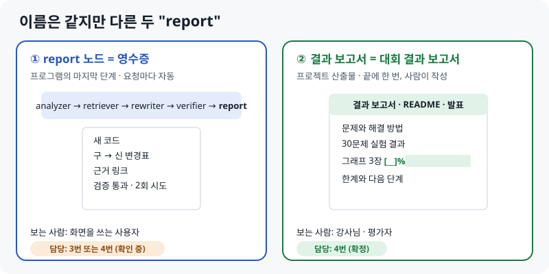
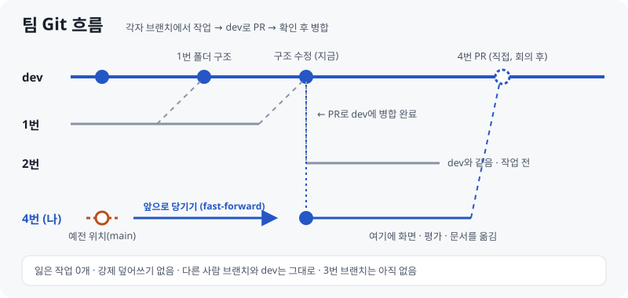

# 팀 진행 상황과 내 역할

> **최신 버전 · 2026-10-13**  
> 웹에서 보기: [HTML](https://skn35shimsungwook.github.io/langchain-migration-helper/docs/guide_v2/03_팀_진행상황.html) · 인쇄용: [PDF](03_팀_진행상황.pdf)  
> 함께 읽을 문서: [01 프로젝트 한눈에](01_프로젝트_한눈에.md) · [02 화면·평가 파트](02_화면평가_파트.md) · [역할분담표](../역할분담표.md)  
> 팀원은 **역할 번호(1~4번)로만** 적습니다. 4번이 이 저장소의 주인(나)입니다.

## 이것 세 줄만 기억해도 됩니다

1. 팀 저장소는 아직 **뼈대만 있는 단계**이고, 4번 쪽(평가 도구, 화면, 합의안)은 개인 저장소에 **대부분 만들어져 있습니다.**
2. 팀 대화에서 정한 **"버전을 골라서 돌리는 챗봇"**과 팀 코드(`MigrateState`, 함수 호출)에 맞춰 **화면과 합의안 3종을 1.1로 고쳤습니다.**
3. 팀 저장소에는 **4번이 직접, 회의에서 확인받은 뒤에** 올립니다. 이 저장소의 작업은 팀 저장소를 건드리지 않습니다.

---

## 1장. 한눈에 보기


| 번호 | 역할 | 팀 저장소에 올라온 것 | 다음 일 |
|---|---|---|---|
| 1번 | 그래프 · 백엔드 | 폴더 구조, `MigrateState`, 빈 그래프 틀 | 노드 연결, `run_migration()` 함수 |
| 2번 | 데이터 · 검색 | (아직 없음) | 원문 · 벡터 DB, `symbol_map.json`, retriever |
| 3번 | 변환 · 검증 | (아직 없음, 브랜치도 없음) | analyzer, rewriter, verifier, (report 노드는 확인 중) |
| **4번** | **화면 · 평가** | (개인 저장소에 있음) | 팀 저장소로 옮기기, 실험, 결과 채우기 |

## 2장. 팀 저장소 현재 상태 (2026-10-13 낮)

**브랜치**

| 브랜치 | 상태 |
|---|---|
| `main` | 처음 만든 상태 그대로 |
| `dev` | 1번이 폴더 구조를 올림 (PR 2개 병합) |
| 1번 작업 브랜치 | dev에 병합 완료 |
| 2번 브랜치 | dev와 같음, 작업 전 |
| 4번 브랜치 | 사용자 요청으로 **dev 최신 상태로 앞당김** (fast-forward, 잃은 작업 0개) |
| 3번 브랜치 | 아직 없음 |

**dev 안에 있는 것**

```text
├── app.py              print('Hello World!')  ← 화면 자리
├── pyproject.toml      uv, Python 3.12, langchain>=1.4.4, langgraph, pydantic
├── .env.example        OPENAI_API_KEY
├── data/               비어 있음
└── src/
    ├── agents/         analyzer · retriever · rewriter · verifier · report.py (거의 빈 파일)
    ├── graph/state.py  MigrateState
    ├── graph/supervisor.py  노드 없는 그래프 틀
    └── prompt/  rag/   비어 있음
```

**눈여겨볼 코드**: 1번이 만든 `MigrateState`는 "옛 위치 → 새 위치 + 근거 ID + 최신 방식인지 classic 우회인지"입니다. `kind: native / classic_fallback`은 평가에서 따로 세는 **classic 의존**과 같은 구분입니다.

```python
class MigrateState(BaseModel):
    old: str
    new: str
    evidence_id: str
    kind: Literal["native", "classic_fallback"]
```

## 3장. 팀 대화 정리 (역할 번호로)

**서비스 정의 (모두 동의)**: 구버전 코드를 넣고 **목표 버전을 골라** 실행하면, 새 코드와 **검증 과정이 리포트로** 나오는 챗봇. 파이프라인 흐름은 1번이 그린 흐름도(오프라인 준비 + 5단계)가 기준입니다.

**역할이 정해진 과정**

| 순서 | 내용 |
|---|---|
| 1 | 4번이 역할을 "1 그래프 · 백엔드 / 2 데이터 · 검색 / 3 변환 · 검증 / 4 화면 · 평가"로 정리 |
| 2 | 3번은 처음에 "rewriter + verifier"와 "tester + UI"로 나누는 안을 냈고, **tester(평가)에 report까지 들어간다**고 생각했음 |
| 3 | 3번 의견: 발표에 테스트셋이 들어가고, **비교는 한 사람이 맡아야** 함 → 4번이 준비한 평가 방식과 같음 |
| 4 | 1번이 3번에게 UI를 부탁했지만, 3번은 UI 말고는 모두 괜찮다고 함 |
| 5 | 최종: **1 그래프 · 백엔드 / 2 데이터 · 검색 / 3 변환 · 검증 / 4 화면 · 평가** (모두 동의) |

**협업 규칙**

- 1번이 dev에 폴더 구조를 올림 → **각자 브랜치에서 작업 → dev로 PR → 병합**
- 병합 담당을 두자는 이야기가 나왔지만 정하지 않음
- **매일 점심 13:40 모임**

**데이터**: 2번은 처음에 벡터 DB만 공유하려다가, 용량이 커서 "스크립트로 각자 만들기"를 생각함 → 1번 의견으로 **원문과 벡터 DB를 모두 Git에 올리기**로 함.

**우선순위**: 1번은 "LLM 답변이 잘 나오는지 먼저 확인하고 키우자", 3번은 "산출물 report 폴더는 여유가 있으면"으로 정리됨. **동작하는 최소 버전이 먼저**입니다.

**아직 정하지 않은 것**

| 미정 | 왜 중요한가 |
|---|---|
| report 노드 담당 (3번 또는 4번) | 3번은 처음에 report를 평가 쪽으로 생각했음 |
| 목표 버전을 어떻게 받나 | 모두 "버전 골라서"라고 했지만 설계에 없었음 → **4번이 화면과 합의안에 추가함** |
| 화면이 그래프를 부르는 방법 | HTTP 서버인지, 같은 프로그램 안에서 함수로 부르는지 → **함수 호출을 기본안으로 제안** |
| 병합 담당, 비교 모델 | 평가 공정성(같은 모델)과 PR 순서 |

## 4장. 내 역할 (4번 · 화면 · 평가)

| 영역 | 개인 저장소에 있는 것 | 상태 |
|---|---|---|
| **평가** | 규칙, 테스트셋 30개, 판정기(import · 속성), 일반 AI 실험기, 우리 시스템 실험기, 그래프, 검사기 2종 | ✅ 도구 완성, ⏳ 실험 전 |
| **화면** | Streamlit 두 탭, 가짜 응답, 연결 상태 배지, **목표 버전 선택 (오늘 추가)** | 🟡 뼈대 완성 |
| **팀 약속** | 합의안 3종 + 예시 + 연습용 서버, **1.1로 팀 코드에 맞춤 (오늘)** | 🟡 회의에서 공유 |
| **보고서 · README · 발표** | 발표 14장, 안내서 3개, README | 🟡 결과 숫자는 실험 후 |

**오늘 팀 코드에 맞춰 고친 것 (1.1)**

| 어긋났던 점 | 고친 것 | 확인 |
|---|---|---|
| 목표 버전 선택이 없었음 | 화면에 **목표 버전** 선택, 요청과 report에 `target_version` 추가 (지금은 `1.x`) | 화면 자동 테스트, 형식 검사 통과 |
| 팀에는 FastAPI가 없고 화면이 같은 저장소에 있음 | **함수 호출이 기본안**: `MIGRATION_FUNC="src.graph.supervisor:run_migration"`. HTTP는 선택으로 남김 | 가짜 그래프 함수로 화면 · 평가 연결, 오류 안내 확인 |
| symbol_map과 `MigrateState` 이름이 다름 | 파일 모양은 그대로 두고 **연결표** 추가 (`new_import`/`fallback_import` → `new`, `kind`) | 합의안 0장 |
| report 노드 담당이 애매함 | 합의안에 "확정 전, 4번이 맡을 수도 있음" 표시 | 회의에서 확인 |

**팀 저장소에 옮길 자리 (계획)** — 1번에게 확인받은 뒤 **4번이 직접** 올립니다. 이 구조 그대로 모은 사본이 [for_team_repo/](../../for_team_repo/)에 있어서, 덮어 복사만 하면 됩니다 (바뀌는 기존 파일은 `app.py` 하나).

| 개인 저장소 | 팀 저장소 |
|---|---|
| `app/streamlit_app.py` | `app.py` |
| `app/backend.py` | `src/ui/` |
| `eval/` (평가 전체) | `eval/` |
| `docs/` (합의안 · 예시) | `docs/` |
| 화면 의존성 | `streamlit`을 `pyproject.toml`에 추가 (`uv add streamlit`) |

**팀에 제안할 것**: 빠진 의존성(`langchain-openai`, `qdrant-client`), 팀 README의 폴더 구조 정리(4번 담당), 벡터 DB는 GitHub 파일 제한(100MB)이 있어 **"만드는 스크립트" 공유**나 Git LFS.

## 5장. 오늘 물어본 것 정리

### Q1. report 노드가 보고서인가요?

**아니요, 이름만 같고 다른 것입니다.**



| | report 노드 | 결과 보고서 |
|---|---|---|
| 정체 | 파이프라인 ⑤번째 단계 (프로그램) | 프로젝트 결과 문서 |
| 언제 | 코드를 넣을 **때마다** 자동으로 | 프로젝트 끝에 **한 번** |
| 내용 | 새 코드, 변경표, 근거 링크, 검증 결과, 시도 횟수 | 문제, 해결, 실험 결과, 한계, 결론 |
| 주방 비유 | 요리와 함께 나오는 **영수증 · 원산지 표시** | 대회가 끝난 뒤 쓰는 **결과 보고서** |
| 담당 | 3번 또는 4번 (확인 중) | **4번 (확정)** |

회의에서 이렇게 물어보면 됩니다: "report가 두 가지라서요. ① report 노드는 화면에 보여 줄 모양을 제가 정했으니 제가 맡아도 괜찮아요. ② 결과 보고서는 제가 쓸게요. 말씀하신 '산출물 report 폴더'는 변환 결과를 파일로 쌓아 두는 폴더인가요?"

### Q2. 내 브랜치가 dev 이전(main) 상태에 멈춰 있어요

**dev 최신 상태로 앞당겼습니다 (사용자 요청).** 4번 브랜치에만 있던 커밋이 0개라서, 강제로 덮어쓰지 않고 위치만 앞으로 옮겼습니다. 열려 있던 PR(1번 브랜치 → 4번 브랜치)은 자동으로 "병합됨"이 되었습니다.



> 이 일 이후 원칙: **팀 저장소는 개인 저장소 작업에서 건드리지 않습니다** (4번 브랜치 포함). 팀 저장소에 올리는 일은 4번이 직접 합니다.

### Q3. `cd 폴더 && uv sync`가 PowerShell에서 에러가 나요

Windows PowerShell 5.1은 `&&`로 명령을 이어 붙일 수 없습니다. **한 줄씩 따로** 실행하면 됩니다.

```powershell
git clone -b <4번 브랜치> https://github.com/SKNETWORKS-FAMILY-AICAMP/SKN35-3rd-4Team.git
cd SKN35-3rd-4Team
uv sync
git branch          # * <4번 브랜치> 가 보이면 됨
```

| 증상 | 원인 | 해결 |
|---|---|---|
| `'&&' 토큰은 이 버전에서 올바른 문 구분 기호가 아닙니다` | PowerShell 5.1 문법 | 한 줄씩 실행하거나 `;` 사용 |
| 다른 Git 폴더(`eq-test`) 안에 내려받음 | 내려받을 때 있던 위치 | 바탕화면으로 옮기기: 상위 폴더에서 `Move-Item .\eq-test\SKN35-3rd-4Team .` |

### Q4. 개인 저장소와 팀 저장소는 어떻게 나눠 쓰나요?

| | 개인 저장소 (이 저장소) | 팀 저장소 |
|---|---|---|
| 용도 | 4번 작업장 · 기록 · 안내서 · 발표 사본 | 팀 제출용 코드 |
| 누가 바꾸나 | 4번 (AI 도움 포함) | 각 담당자가 **직접**, PR로 |
| 공개 범위 | 공개 → **팀원 이름 · 대화 원문은 넣지 않음**, 역할 번호만 | 팀 |

## 6장. 13:40 회의 안건 (말할 순서)

1. "평가 도구랑 화면 뼈대는 거의 만들어 뒀어요." → 바로 쓸 수 있는 것부터
2. **3번에게**: "verifier의 import · 속성 검사는 `verify.py`를 그대로 쓰시면 돼요. 테스트도 끝났어요."
3. **report 노드**: "화면에 보여 줄 모양을 제가 정했으니 제가 맡아도 될까요?"
4. **1번에게**: "화면에서 그래프를 `run_migration(code, target_version)` 함수 하나로 부르면 될까요?" / "제 파일은 `app.py`, `src/ui/`, `eval/`, `docs/`에 넣어도 될까요?"
5. **목표 버전**: "일단 1.x 하나로 시작해도 될까요?"
6. **2번에게**: "symbol_map은 `MigrateState`(old, new, evidence_id, kind)와 이어지게 해 뒀어요. 근거 ID 규칙만 같이 정해요." / 벡터 DB 용량
7. **다 같이**: 비교 모델, 최대 시도(2 또는 3회), 병합 담당

## 7장. 할 일 순서

| 순서 | 할 일 | 언제 |
|---|---|---|
| 1 | 팀 저장소를 바탕화면으로 옮기고 `uv sync` | 회의 전 |
| 2 | 13:40 회의에서 6장 안건 공유 | 점심 |
| 3 | 답을 받으면 합의안 3종을 "확정"으로 | 회의 후 |
| 4 | `for_team_repo/`를 4번 브랜치에 덮어 복사하고 **직접** dev로 PR | 1번 확인 후 |
| 5 | 3번에게 `verify.py` 사용법 설명 | 회의 후 |
| 6 | 팀 그래프가 나오면 `MIGRATION_FUNC`로 화면 연결 → 실험 → 결과 채우기 | 이후 |
