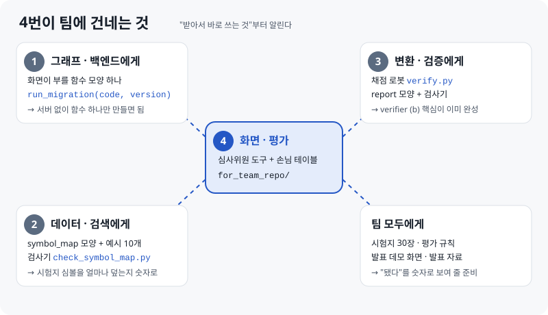

# 팀 보고 준비

> **최신 버전 · 2026-10-13**  
> 웹에서 보기: [HTML](https://skn35shimsungwook.github.io/langchain-migration-helper/docs/guide_v2/04_팀_보고_준비.html) · 인쇄용: [PDF](04_팀_보고_준비.pdf)  
> 함께 읽을 문서: [03 팀 진행 상황](03_팀_진행상황.md) · [02 화면·평가 파트](02_화면평가_파트.md)  
> 팀원은 **역할 번호(1~4번)로만** 적습니다. 4번이 나입니다.

## 이것 세 줄만 기억해도 됩니다

1. 회의의 첫 마디는 **"평가 도구랑 화면 뼈대는 거의 만들어 뒀어요. 각자 바로 가져다 쓰실 수 있는 게 있어요."**입니다.
2. 자랑이 아니라 **"상대에게 무엇이 편해지는지"**부터 말합니다: 1번은 함수 하나, 2번은 검사기, 3번은 채점 로봇.
3. "거의"는 정직하게 말합니다: **도구는 다 있고, 실제 결과 숫자는 팀 챗봇이 나와야** 채워집니다.

---

## 1장. 이 한 문장의 뜻

> "평가 도구랑 화면 뼈대는 거의 만들어 뒀어요." → 팀이 바로 쓸 수 있는 것부터 알리기

| 말의 조각 | 정확한 뜻 | 왜 이렇게 말하나 |
|---|---|---|
| **평가 도구** | 시험지 30장, 채점 로봇, 두 선수(일반 AI · 우리 프로그램) 시험 기계, 그래프 기계, 검사기 2종 | 4번이 "증명" 담당이라는 걸 한 번에 알림 |
| **화면 뼈대** | 손님 테이블(Streamlit). 목표 버전 고르기 → 코드 넣기 → 결과 · 근거 · 검증 배지 | 발표 데모가 이미 가능하다는 안심 |
| **거의** | 도구는 완성, **실제 결과 숫자만 비어 있음** (팀 챗봇이 있어야 채움) | 과장하지 않아야 신뢰가 생김 |
| **바로 쓸 수 있는 것부터** | "내가 뭘 했는지"가 아니라 **"당신이 뭘 안 해도 되는지"** | 팀원이 부담 없이 받아들임 |

**주방 비유**: 요리사(1~3번)가 아직 요리를 시작하기 전에, 심사위원(4번)이 **채점표, 시험 메뉴 30개, 손님 테이블**을 미리 차려 둔 상태입니다. 게다가 요리사가 쓸 **맛 검사기(채점 로봇)**도 빌려줄 수 있습니다.

## 2장. 내가 만든 것 (팀이 바로 쓸 수 있는 순서)

| 순서 | 만든 것 | 누가 바로 쓰나 | 상대가 덜 해도 되는 일 | 상태 |
|---|---|---|---|---|
| 1 | **채점 로봇** `eval/verify.py` (import · 속성 검사) | **3번** verifier (b) | 샌드박스 검사를 처음부터 만들 필요 없음. 평가 채점과 기준도 같아짐 | ✅ 판정 10가지 경우 모두 통과 |
| 2 | **report 모양 + 검사기** `출력모양_합의안.md`, `check_contract.py` | **3번** (report) | 화면 · 평가용 출력을 따로 고민할 필요 없음. 만든 report를 바로 검사 | ✅ 예시 2개 통과 |
| 3 | **화면이 부를 함수 모양** `run_migration(code, target_version) → report` + 연결 코드 `src/ui/backend.py` | **1번** | HTTP 서버를 따로 만들 필요 없음. 함수 하나만 열어 주면 화면 · 평가가 바로 붙음 | ✅ 가짜 함수로 연결 확인 |
| 4 | **symbol_map 모양 + 예시 10개 + 검사기** `check_symbol_map.py` | **2번** | 새 위치가 진짜 import되는지, 시험지 심볼을 얼마나 덮는지 바로 숫자로 | ✅ 예시 10개 통과 |
| 5 | **화면** `app.py` (가짜 응답으로 동작) | 모두 (발표 데모) | 데모 화면을 따로 만들 필요 없음 | 🟡 팀 챗봇 연결 전 |
| 6 | **시험지 30장 + 평가 규칙** `testset.json`, `EVAL_RULES.md` | 모두 | 테스트할 코드를 찾을 필요 없음 (쉬움 · 중간 · 어려움 10개씩, 모두 최신 환경에서 깨짐 확인) | ✅ 30/30 |
| 7 | **일반 AI 시험 기계** `run_baseline.py` | 4번 (지금 바로) | 팀 챗봇과 상관없이 **API 키만 있으면 지금 실행 가능** | ✅ 흐름 확인, 실제 실행 전 |
| 8 | 우리 프로그램 시험 기계 · 그래프 기계 | 4번 | – | ✅ 완성, 팀 챗봇 필요 |

모든 파일은 팀 저장소 구조 그대로 [for_team_repo/](../../for_team_repo/)에 모아 두었습니다.

## 3장. "거의"의 정확한 범위

| 완성 (지금 보여 줄 수 있음) | 아직 (팀 챗봇이 있어야 함) |
|---|---|
| 시험지 30장, 채점 로봇, 검사기 2종 | 우리 프로그램(B)의 실제 결과 |
| 일반 AI 시험 기계 (API 키만 있으면 실행) | 실제 그래프 3장과 성공률 숫자 |
| 화면: 목표 버전 · 결과 · 근거 · 배지 (가짜 응답) | 화면의 실제 변환 결과 |
| 합의안 3종 (1.1), 안내서, 발표 14장 초안 | 발표 자료의 `[__]` 숫자 |
| 팀 저장소용 사본 폴더 | 팀 저장소에 올리기 (1번 확인 후) |

**질문을 받으면**: "도구는 다 만들어 뒀고, 챗봇이 나오면 같은 날 바로 결과를 뽑을 수 있어요. 일반 AI 쪽 결과는 키만 정하면 오늘이라도 먼저 뽑을 수 있어요."

## 4장. 팀 저장소에서 새로 만든다면 (할 일 순서)

팀 저장소는 지금 **1번의 뼈대만 있는 상태**입니다. 그 위에 4번 파일을 새로 올린다고 가정하면, 순서는 **"남을 기다리지 않는 일 먼저"**입니다.

| 단계 | 할 일 | 누구를 기다리나 | 끝났다는 표시 |
|---|---|---|---|
| 0 | 회의에서 확인: `app.py` 자리에 화면, `src/ui/`, `eval/`, `docs/` 추가해도 되는지 | 1번 답 | "네" |
| 1 | 내 브랜치에 `for_team_repo/` 덮어 복사 → `uv add streamlit` → dev로 PR | 1번 확인 | PR 병합 |
| 2 | 팀 저장소에서 화면 켜 보기 (가짜 응답) | 없음 | 화면에 예제 변환 결과 |
| 3 | **일반 AI(A) 실험 먼저**: 3문제 → 30문제 | 팀이 비교 모델 · API 키 정하기 | `results/A_…json` |
| 4 | 3번에게 `verify.py` 사용법 설명 | 없음 | 3번 verifier에서 `judge()` 사용 |
| 5 | 2번 symbol_map이 나오면 `check_symbol_map.py --testset`으로 대조 | 2번 파일 | 덮는 심볼 수 숫자 |
| 6 | 1번 `run_migration()`이 나오면 `MIGRATION_FUNC`로 화면 연결 | 1번 함수 | 초록 배지 "팀 그래프 직접 호출" |
| 7 | 3번 report를 `check_contract.py`로 검사 | 3번 report | `[PASS]` |
| 8 | 우리 프로그램(B) 30문제 → 그래프 3장 | 팀 챗봇 완성 | `charts/` 3장 |
| 9 | README · 보고서 · 발표 `[__]` 채우기, 데모 녹화 | 8번 결과 | 발표 리허설 |

**핵심**: 3단계(일반 AI 실험)는 팀 챗봇이 없어도 할 수 있습니다. 이걸 먼저 해 두면, 챗봇이 나온 날 B만 돌려서 바로 비교할 수 있습니다.

## 5장. 팀원에게 보고하는 방법

**말하는 원칙 세 가지**

1. **상대에게 좋은 점 먼저**: "제가 ○○ 만들었어요"보다 "○○님은 이거 안 만드셔도 돼요".
2. **부탁은 질문으로**: "이렇게 하세요"가 아니라 "이렇게 해도 될까요?".
3. **결정할 것은 세 개만**: 회의에서 정할 것을 많이 꺼내면 아무것도 안 정해집니다.

### 13:40 회의에서 1분 말하기 (대본)

> "4번 쪽 상황 짧게 말씀드릴게요.
> 평가 도구랑 화면 뼈대는 거의 만들어 뒀어요. 각자 바로 가져다 쓰실 수 있는 게 있어서 그것부터 말씀드릴게요.
> **3번님**, verifier에서 import랑 속성 검사하는 부분은 제가 만든 `verify.py`를 그대로 쓰시면 돼요. 테스트도 끝났어요.
> **1번님**, 화면은 그래프를 `run_migration(code, target_version)` 함수 하나로 부르게 해 뒀어요. 서버 없이 이 함수만 있으면 바로 붙어요.
> **2번님**, symbol_map 예시랑 검사기가 있어서, 만드시면 시험지 심볼을 얼마나 덮는지 바로 숫자로 나와요.
> 아직 남은 건 실제 결과 숫자예요. 챗봇이 나오면 같은 날 바로 뽑을 수 있게 준비해 뒀어요.
> 오늘 정하고 싶은 건 세 가지예요. report 노드를 누가 할지, 화면을 이 함수 방식으로 붙여도 될지, 비교에 쓸 모델이요."

### 디스코드 전체 공지 (복사해서 사용)

> 📌 4번(화면 · 평가) 진행 공유
> 평가 도구랑 화면 뼈대는 거의 만들어 뒀어요! 팀 저장소 구조 그대로 모아 둔 폴더예요 👉 https://github.com/SKN35shimsungwook/langchain-migration-helper/tree/main/for_team_repo
>
> - 1번: 화면은 `run_migration(code, target_version)` 함수 하나로 그래프를 불러요 (서버 필요 없음)
> - 2번: symbol_map 예시 10개 + 검사기 있어요 (`check_symbol_map.py`)
> - 3번: verifier (b)는 `eval/verify.py`의 `judge()`를 그대로 쓰시면 돼요
> - 남은 것: 실제 결과 숫자 (챗봇 나오면 바로 뽑음)
>
> 팀 저장소에 올리는 건 1번님 확인받고 제 브랜치에서 PR로 올릴게요 🙏

### 역할별 1:1 메시지 (복사해서 사용)

**1번에게**
> 1번님, 화면이랑 평가에서 그래프 부르는 방식 맞추려고요! `src/graph/supervisor.py`에 `run_migration(code: str, target_version: str = "1.x") -> dict` 함수 하나만 있으면 화면이 바로 붙어요. 돌려주는 dict 모양은 출력 모양 합의안에 있어요.
> 그리고 제 파일은 `app.py`(지금 Hello World 자리), `src/ui/`, `eval/`, `docs/`에 넣으려는데 괜찮을까요? 기존 파일 중에 바뀌는 건 `app.py` 하나예요.

**2번에게**
> 2번님, symbol_map 한 줄 모양이랑 근거 ID 규칙(`문서#섹션-번호`) 합의안 만들어 뒀어요. 1번님이 만든 `MigrateState`(old, new, evidence_id, kind)랑도 이어지게 해 뒀어요.
> 만드시면 `check_symbol_map.py`로 새 위치가 진짜 import되는지랑 시험지 57개 심볼을 얼마나 덮는지 바로 나와요. 벡터 DB는 GitHub 파일 제한(100MB)이 있어서 만드는 스크립트로 공유하는 것도 같이 얘기해 봐요!

**3번에게**
> 3번님, verifier (b)는 제가 만든 `eval/verify.py`의 `judge(code, python경로)`를 그대로 쓰시면 돼요. import랑 속성 검사까지 테스트 끝났고, 평가 채점이랑 기준이 똑같아져서 공정성도 챙길 수 있어요.
> report 모양은 출력 모양 합의안에 예시 2개 있고, `check_contract.py`로 바로 검사돼요. 그리고 report 노드는 화면에 보여 줄 모양을 제가 정해서, 원하시면 제가 맡아도 괜찮아요!

### PR 설명 (팀 저장소에 올릴 때)

> **4번: 화면 · 평가 파일 추가**
>
> - 바뀌는 기존 파일: `app.py` (Hello World → Streamlit 화면)
> - 새 파일: `src/ui/` (그래프 호출 · 가짜 응답), `eval/` (시험지 · 채점 로봇 · 실험 · 그래프), `docs/` (합의안 3종, 예시)
> - 의존성: `streamlit` 추가
> - 확인: 가짜 응답으로 화면 동작, 시험지 30/30, report 예시 형식 검사 통과
> - 다른 사람 폴더(`src/agents`, `src/graph`, `src/rag`, `data/`)는 건드리지 않았습니다.

## 6장. 예상 반응과 답

| 팀원 반응 | 이렇게 답하기 |
|---|---|
| "벌써 그걸 다 했어요?" | "도구만이에요. 진짜 결과는 다들 만드시는 게 있어야 나와요." |
| "verify.py를 꼭 써야 해요?" | "편하실 때만요. 다만 같은 걸 쓰면 평가에서 채점 기준이 같아져서 좋아요." |
| "함수 말고 API로 할게요." | "그것도 준비해 뒀어요. 주소만 알려 주시면 돼요 (HTTP 방식)." |
| "report 노드는 제가 할게요." | "좋아요! 모양만 합의안대로 맞춰 주시면 화면이랑 평가가 바로 붙어요." |
| "app.py는 제가 쓰려고 했는데요." | "그럼 화면은 `pages/`나 다른 파일 이름으로 둘게요. 어디가 편하세요?" |

## 7장. 오늘 체크리스트

| 순서 | 할 일 |
|---|---|
| 1 | 1분 대본 소리 내어 한 번 읽기 |
| 2 | 회의에서 정할 것 3개 받기: report 노드 담당, 함수 방식, 비교 모델 |
| 3 | 디스코드 전체 공지 올리기 |
| 4 | 1:1 메시지 보내기 (1번 → 3번 → 2번 순서) |
| 5 | 1번 확인 후 `for_team_repo/` 복사 → PR (5장 PR 설명 사용) |
| 6 | 비교 모델이 정해지면 일반 AI 실험 3문제부터 |
