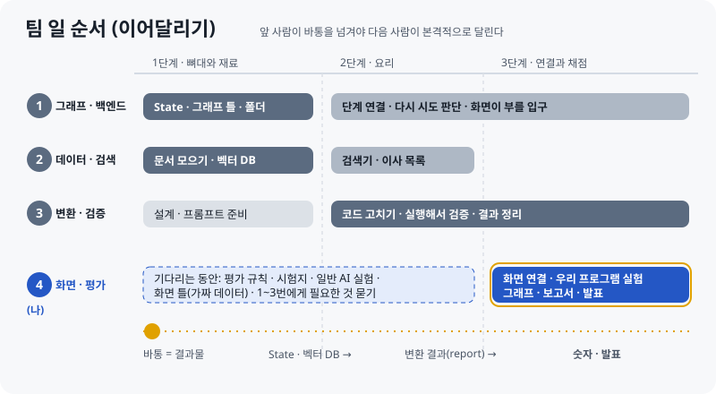

# 처음부터 다시 보기

> **최신 버전 · 2026-10-13**  
> 웹에서 보기: [HTML](https://skn35shimsungwook.github.io/langchain-migration-helper/docs/guide_v2/05_처음부터_다시_보기.html) · 인쇄용: [PDF](05_처음부터_다시_보기.pdf)  
> 이 문서가 [04 팀 보고 준비](04_팀_보고_준비.md)를 대신합니다 (04는 이전 버전).  
> 팀원은 **역할 번호(1~4번)로만** 적습니다. 4번이 나입니다.

## 이것 세 줄만 기억해도 됩니다

1. 이 저장소에 있는 코드와 문서는 **내가 프로젝트를 이해하려고 혼자 연습한 초안**입니다. 팀 결과물이 아닙니다.
2. 실제 프로젝트에서 4번은 **1번 · 2번이 먼저 만든 것을 받아서** 일합니다. 그래서 팀 저장소에서는 **처음부터 새로** 만듭니다.
3. 팀에게는 "다 만들었다"가 아니라 **"순서대로 이어서 하겠다, 기다리는 동안 이것을 준비하겠다"**고 말합니다.

---

## 1장. 이 프로젝트는 무엇인가

**한 문장**: 옛날 방식으로 쓴 LangChain 코드를 넣으면, **최신 버전에서 돌아가는 코드로 고쳐 주고, 진짜 돌아가는지 확인까지 해 주는 챗봇**입니다.

**주방으로 비유하면**

| 진짜 말 | 주방 비유 |
|---|---|
| LangChain | 요리 도구 세트 |
| `import` (코드 첫 줄) | "몇 번 서랍에서 국자를 꺼내라" |
| 버전이 바뀜 (1.0) | 주방을 새로 정리해서 **도구가 다른 서랍으로 이사 감** |
| 옛날 코드 | 옛날 서랍 위치가 적힌 **레시피** |
| 에러 | 서랍을 열었는데 도구가 없음 |

**왜 필요한가**: ChatGPT 같은 AI에게 고쳐 달라고 하면, AI는 **옛날 주방만 기억**하고 있어서 옛날 서랍을 또 알려 줍니다. 그리고 **틀렸다는 것도 모릅니다.**

**우리 챗봇이 다른 점 두 가지**

| | 일반 AI | 우리 챗봇 |
|---|---|---|
| ① 무엇을 보고 고치나 | 기억 (옛날 주방) | **최신 안내서** (공식 문서) |
| ② 고친 뒤 확인하나 | 안 함 | **서랍을 직접 열어 봄** (실제로 실행) |
| 틀리면 | 모름 | 에러를 보고 **다시 찾아서 다시 고침** |

이 두 가지를 **"이중 검증"**이라고 부릅니다. 그리고 **같은 문제 30개로 일반 AI와 우리 챗봇을 비교해서 숫자로 증명**하는 것이 이 프로젝트의 목표입니다.

## 2장. 챗봇은 어떤 순서로 일하나

**미리 한 번 해 두는 일 (준비)**: 최신 안내서(공식 문서)를 잘게 잘라 **검색할 수 있는 창고(벡터 DB)**에 넣고, "옛 위치 → 새 위치" **이사 목록(symbol_map)**을 만들어 둡니다.

**사용자가 코드를 넣을 때마다 (5단계)**

| 단계 | 하는 일 | 주방 비유 |
|---|---|---|
| ① analyzer | 코드에서 어떤 도구를 쓰는지 목록 뽑기 | 레시피의 재료 목록 읽기 |
| ② retriever | 이사 목록과 창고에서 새 위치 찾기 | 안내서에서 새 서랍 찾기 |
| ③ rewriter | AI가 근거를 붙여 코드 다시 쓰기 | 레시피 고쳐 쓰기 |
| ④ verifier | 진짜 실행해 보고 확인. 틀리면 ②로 돌아감 (2~3번까지) | 서랍을 직접 열어 보기 |
| ⑤ report | 새 코드 + 바뀐 곳 + 근거 + 몇 번 만에 됐는지 정리 | 요리와 함께 나가는 영수증 |

**그리고 바깥에**: 사용자가 쓰는 **화면**, 일반 AI와 비교하는 **평가**가 있습니다. 이 두 가지가 4번 몫입니다.

## 3장. 네 명은 어떤 순서로 일하나

팀 일은 **이어달리기**입니다. 앞 사람이 만든 것(바통)을 받아야 다음 사람이 본격적으로 달릴 수 있습니다.

| 번호 | 역할 | 주방 비유 | 무엇을 받아서 | 무엇을 넘기나 |
|---|---|---|---|---|
| 1번 | 그래프 · 백엔드 | 주방 동선과 주문 전달 | (처음 시작) | 뼈대: State(주고받는 정보 모양), 단계 연결, 화면이 부를 입구 |
| 2번 | 데이터 · 검색 | 새 주방 안내서 만들기 | (처음 시작) | 창고(벡터 DB), 이사 목록, 검색기 |
| 3번 | 변환 · 검증 | 요리사와 검수원 | 1번 뼈대 + 2번 검색 | 고친 코드와 결과 정리(report) |
| **4번** | **화면 · 평가** | **손님 테이블과 심사위원** | **1~3번 결과** | **화면, 비교 숫자, 보고서 · 발표** |

**4번이 마지막인 이유**: 화면은 **보여 줄 결과**가 있어야 하고, 평가는 **채점할 챗봇**이 있어야 합니다. 그래서 4번의 본격적인 일은 1~3번 다음입니다.

**그래도 기다리기만 하지 않습니다**: 챗봇이 없어도 할 수 있는 일이 있습니다 (4장 1단계).

## 4장. 4번이 처음부터 할 일 (순서대로)

### 1단계 · 1번 · 2번이 뼈대와 재료를 만드는 동안 (기다리며 준비)

| 할 일 | 왜 지금 할 수 있나 | 결과물 |
|---|---|---|
| **평가 규칙을 팀과 정하기** (같은 모델, 성공 기준, 몇 번까지 다시 시도) | 챗봇이 없어도 규칙은 먼저 정할 수 있음 | `eval/EVAL_RULES.md` |
| **시험지 만들기** (옛날 코드 30개: 쉬움 · 중간 · 어려움 10개씩) | 문제는 챗봇과 상관없음 | `eval/testset.json` |
| **채점 기계 만들기** (코드를 실행해서 되는지 판정) | 채점 방법은 챗봇과 상관없음 | `eval/verify.py` |
| **일반 AI 실험** (같은 30개를 일반 AI에게 풀게 하기) | 비교 상대는 챗봇 없이 지금 바로 가능 | 일반 AI 성공률 |
| **화면 틀** (가짜 데이터로 모양만) | 무엇을 보여 줄지는 먼저 정할 수 있음 | `app.py` 틀 |
| **1~3번에게 필요한 것 묻기** | 연결할 때 헷갈리지 않으려고 | 메모 |

### 2단계 · 1번의 뼈대(State · 입구)가 나온 뒤

| 할 일 | 무엇을 받아서 | 결과물 |
|---|---|---|
| 결과 정리(report) 모양을 3번과 맞추기 | 1번 State | 화면에 보여 줄 항목 목록 |
| 화면이 챗봇을 부르는 방법을 1번과 맞추기 | 1번 입구 | 화면에서 부르는 코드 |

### 3단계 · 2번 · 3번의 결과가 나온 뒤

| 할 일 | 무엇을 받아서 | 결과물 |
|---|---|---|
| 화면을 진짜 챗봇에 연결 | 1~3번 챗봇 | 데모 화면 |
| **우리 챗봇 실험** (같은 30개) | 1~3번 챗봇 | 우리 챗봇 성공률 |
| 비교 그래프 만들기 | 두 실험 결과 | 그래프 3장 |

### 4단계 · 마무리

| 할 일 | 결과물 |
|---|---|
| 보고서 · README 쓰기 (팀 결과를 정리) | 보고서, README |
| 발표 자료 · 데모 녹화 | 발표 자료 |

## 5장. 팀원에게 보고하는 방법

### 하지 말 것과 할 것

| ❌ 하지 말 것 | ✅ 이렇게 |
|---|---|
| "평가 도구랑 화면 다 만들어 뒀어요" | "1번 · 2번 작업 끝나면 이어서 화면이랑 평가 하겠습니다" |
| "이 모양으로 해 주세요" (내가 정한 규칙을 내밀기) | "제가 받을 때 이런 정보가 있으면 좋은데, 어떻게 생각하세요?" |
| 개인 저장소 링크부터 공유 | 팀 저장소에서, 팀이 정한 순서대로 |
| 남의 파트(검증, 검색)까지 내가 설계 | 내 파트(화면 · 평가)만, 필요한 것은 질문으로 |

**왜 "다 만들었다"가 마이너스인가**

- 팀이 정한 **순서(1 · 2번 다음 4번)를 무시**한 것처럼 보입니다.
- 1~3번 입장에서는 **내가 할 일을 남이 정해 버린 것**처럼 느껴질 수 있습니다.
- 실제로는 팀 코드가 나오면 **어차피 다시 맞춰야** 하는 연습본입니다.

**개인 초안은 이렇게 씁니다**: 내 머릿속 정리용입니다. 팀에서 질문을 받았을 때 막힘없이 답하는 데 씁니다. 굳이 말해야 하면 "개인적으로 공부하면서 연습해 봤어요" 정도만 합니다.

### 13:40 회의에서 1분 말하기 (대본)

> "4번 화면 · 평가 맡은 사람입니다.
> 제 일은 1번 · 2번이 뼈대랑 데이터를 만들어 주시면, 3번 결과까지 받아서 화면에 연결하고 일반 AI랑 비교하는 거라서 순서상 뒤쪽이에요.
> 그래서 기다리는 동안은 챗봇 없이도 할 수 있는 것부터 하려고 해요. 평가 규칙 정하기, 시험용 옛날 코드 30개 모으기, 일반 AI 실험이요.
> 같이 정하고 싶은 건 두 가지예요. 일반 AI랑 비교할 때 쓸 모델이랑, 틀렸을 때 몇 번까지 다시 시도할지요.
> 그리고 나중에 연결할 때 헷갈리지 않게, 결과에 어떤 정보가 담기는지는 1번 · 3번 작업하시면서 한 번 같이 봐요."

### 디스코드 공유 (짧게)

> 4번(화면 · 평가) 계획 공유드려요!
> 1 · 2번 작업 끝나면 이어서 화면 연결이랑 비교 실험 할게요.
> 그 전에는 챗봇 없이 할 수 있는 것부터 할게요: ① 평가 규칙 정리 ② 시험용 옛날 코드 30개 ③ 일반 AI 실험
> 비교 모델이랑 다시 시도 횟수는 다음 회의 때 같이 정해요 🙏

### 매일 13:40 짧은 보고 틀

> **어제**: (한 일 한 줄)
> **오늘**: (할 일 한 줄)
> **필요한 것**: (누구에게 무엇이 필요한지, 없으면 "없음")

예시:

> **어제**: 평가 규칙 초안 만들었어요.
> **오늘**: 시험용 옛날 코드 10개 모을게요.
> **필요한 것**: 1번님 State 모양 정해지면 한 번만 공유 부탁드려요.

### 1 · 2 · 3번에게 물어볼 것 (질문으로)

| 누구 | 질문 | 왜 필요한가 |
|---|---|---|
| 1번 | "화면에서 챗봇을 부를 때 어떤 방식이 편하세요? (함수 / 서버)" | 화면 연결 방법 |
| 1번 | "State가 정해지면 공유해 주실 수 있을까요?" | 화면에 보여 줄 정보를 알기 위해 |
| 2번 | "근거 문서 링크도 같이 저장되나요?" | 화면에 "근거 문서 열기"를 넣으려고 |
| 3번 | "검증할 때 어디까지 확인하세요? (import만 / 기능 이름까지)" | 평가 채점 기준을 같게 맞추려고 |
| 3번 | "결과 정리(report) 단계는 누가 맡을지 같이 정해요" | 아직 안 정해짐 |

## 6장. 용어 쉽게

| 용어 | 쉬운 뜻 |
|---|---|
| 마이그레이션 | 옛 버전 코드를 새 버전에 맞게 옮기기 (이사) |
| import | 서랍에서 도구 꺼내기 |
| RAG | 안내서를 찾아보고 답하기 |
| 벡터 DB (Qdrant) | 안내서를 잘게 잘라 넣은 검색 창고 |
| symbol_map | "옛 위치 → 새 위치" 이사 목록 |
| LangGraph / 그래프 | 5단계를 순서대로 잇는 작업 흐름도 |
| State | 단계끼리 주고받는 정보 묶음 |
| report | 결과 정리 (영수증). 프로젝트 보고서와는 다른 것 |
| baseline | 비교 상대 = 일반 AI |
| 테스트셋 | 시험지 (옛날 코드 30개) |
| Streamlit | 파이썬으로 화면을 쉽게 만드는 도구 |
| 브랜치 / PR | 내 작업 공간 / "내 작업 합쳐 주세요" 요청 |
