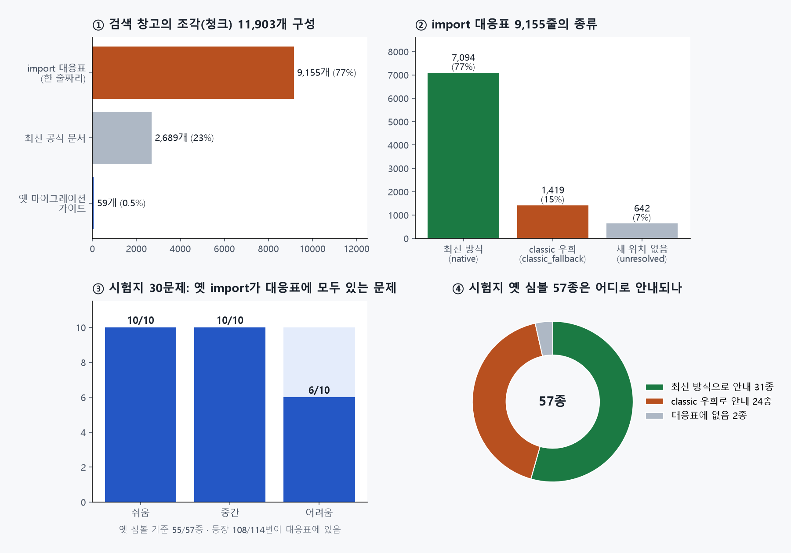

# 2번 데이터 분석

> **최신 버전 · 2026-10-13** · 팀 저장소 **2번 브랜치** (2026-10-13 12:41 커밋 기준)을 읽기만 해서 분석했습니다  
> 웹에서 보기: [HTML](https://skn35shimsungwook.github.io/langchain-migration-helper/docs/guide_v2/06_데이터_분석.html) · 인쇄용: [PDF](06_데이터_분석.pdf)  
> 팀원은 **역할 번호(1~4번)로만** 적습니다. 4번(나)이 공부하려고 만든 분석이고, 2번의 작업을 평가하려는 문서가 아닙니다.

## 이것 세 줄만 기억해도 됩니다

1. 2번이 **문서 297개 → import 대응표 9,155줄 → 검색 조각 11,903개 → 벡터 DB → 검색기**까지 한 번에 만들었습니다. 양도 많고 구조도 탄탄합니다.
2. 우리 시험지(옛 코드 30개)의 옛 import 57종 중 **55종이 대응표에 있고**, 안내하는 새 위치 55개 중 **53개가 실제로 import**됩니다. 나머지 2개는 시험 환경에 패키지가 없어서입니다.
3. 확인해 볼 점은 **없어진 옛 체인 · 에이전트 24종을 대응표가 "classic 우회"로 안내**한다는 것입니다. 최신 방식(LCEL, create_agent) 설명은 가이드 문서 조각에 있습니다.

---

## 1장. 무엇이 올라왔나

**주방 비유**: 2번은 **새 주방 안내서**를 만드는 사람입니다. 이번에 올라온 것은 안내서 원본, "옛 서랍 → 새 서랍" 이사 목록, 그리고 그것을 잘게 잘라 넣은 **검색 창고**와 **찾아 주는 사람(검색기)**입니다.

| 순서 | 한 일 | 결과 파일 | 규모 |
|---|---|---|---|
| 1 | 버전별 도구 목록 뽑기 (LangChain 0.0.300 ~ 1.4.4 등 23개 패키지 버전) | `data/raw/symbols/*.jsonl` | 버전당 수십 ~ 7,800개 |
| 2 | 최신 공식 문서 모으기 | `data/raw/docs/latest/` | 271개 (약 4.4MB) |
| 3 | 옛 마이그레이션 가이드 모으기 (0.3 시점) | `data/raw/docs/migration/` | 24개 (체인 13 · 메모리 5 · 버전 안내 5 · 에이전트 1) |
| 4 | **import 대응표** 만들기 (옛 위치 → 새 위치, 실제 import 확인까지) | `data/processed/import_map.jsonl` | 9,155줄 |
| 5 | 검색용 조각(청크) 만들기 | `data/processed/chunks.jsonl` | 11,903개 |
| 6 | 벡터 DB (Chroma, OpenAI `text-embedding-3-small`, 1536차원) | `data/vectordb/chroma/` | 11,903개 (조각 수와 같음) |
| 7 | 검색기 (대응표 정확 매칭 + 문서 하이브리드 검색) | `src/rag/retrieval/` | – |

## 2장. 숫자로 보기

**① 검색 창고 구성**: 조각 11,903개 중 **77%가 대응표 한 줄짜리**(평균 170자 안팎)입니다. 최신 문서는 2,689개(중간값 902자), 옛 가이드는 **59개**뿐이지만 하나가 깁니다(중간값 3,144자, 최대 8,062자).

**② 대응표 종류**

| 종류 | 줄 수 | 뜻 |
|---|---|---|
| 최신 방식 (native) | 7,094 (77%) | 새 위치로 바로 옮기면 됨 |
| classic 우회 (classic_fallback) | 1,419 (15%) | 1.x에서 없어져 `langchain_classic`에만 남음 |
| 새 위치 없음 (unresolved) | 642 (7%) | 옮길 곳을 못 찾음 |

실제 import 확인 결과: 성공 8,001 · 패키지 없음 488 (예: `langchain_google_community`) · 오류 19 · 의존성 없음 5.

**품질 점검**

| 항목 | 결과 |
|---|---|
| 같은 옛 위치가 두 번 나오는 줄 | 0개 |
| 너무 짧은 조각 (80자 미만) | 0개 |
| 너무 긴 조각 (4,000자 초과) | 69개 |
| 내용이 완전히 같은 조각 | 7개 |
| 근거 ID (`chunk_id`) | 11,903개 모두 있음 (`imap-…`, `doc-…` 형식) |
| 원문 링크 (`url`) | 2,748개 (문서 조각만, 대응표 조각에는 없음) |

## 3장. 우리 시험지와 대조

4번의 시험지(옛 코드 30개)에 나오는 옛 import 57종(등장 114번)을 대응표에서 찾아봤습니다.

| 확인 | 결과 |
|---|---|
| 대응표에 있음 | **55/57종** (등장 기준 108/114번) |
| 새 위치가 실제로 import됨 (LangChain 1.4.4 환경) | **53/55** |
| import 실패 2개 | `langchain_chroma` 미설치, `load_tools`의 의존성(`mypy_extensions`) 미설치 → **데이터 문제가 아니라 시험 환경 문제** |
| 대응표에 없음 | `langchain.tools.tool` (4문제), `langchain.hub` (2문제) |
| 난이도별 "옛 import가 모두 대응표에 있는 문제" | 쉬움 10/10 · 중간 10/10 · **어려움 6/10** |

**대응표에 없는 2개에 대해**: `langchain.tools.tool`은 1.x에서도 **위치가 그대로**라서 이사 목록에 없는 것이 자연스럽습니다. `langchain.hub`는 1.x에서 빠진 기능입니다.

**새 위치가 시험지 정답과 다른 경우**: 대부분 문제가 아닙니다.

| 옛 위치 | 대응표 안내 | 시험지 정답 방향 | 해석 |
|---|---|---|---|
| `langchain.vectorstores.Chroma` | `langchain_chroma.Chroma` | `langchain_community.vectorstores` | 대응표 쪽이 **더 최신 경로**. 평가는 import 성공으로 판정하므로 둘 다 인정됨 |
| `langchain.agents.Tool` | `langchain_core.tools.Tool` | (정답은 `@tool`로 바꿈) | 둘 다 가능 |
| 옛 체인 · 메모리 · 에이전트 24종 | `langchain_classic.…` | LCEL, `create_agent` 등 **구조를 바꿈** | 4장 확인 1 |

## 4장. 확인해 볼 점 (2번에게 질문으로)

2번의 검색기는 이미 **대응표와 문서를 따로 찾고**, 실패하면 **범위를 넓혀 다시 찾도록** 잘 설계되어 있습니다. 그래서 아래는 "고쳐야 할 것"이 아니라 **같이 확인해 보고 싶은 것**입니다.

| # | 본 것 | 왜 궁금한가 | 물어볼 말 |
|---|---|---|---|
| 1 | 시험지의 옛 체인 · 에이전트 24종을 대응표가 **classic 우회**로 안내 | 챗봇이 대응표만 따르면 "통과는 하지만 옛 방식"이 됨. 평가의 **classic 의존 비율**이 올라갈 수 있음 | "LLMChain처럼 없어진 것은 rewriter가 가이드 문서를 같이 보고 LCEL로 바꾸는 흐름일까요?" (3번과 함께) |
| 2 | 옛 가이드 조각에 가중치 0.8 | LLMChain → LCEL 같은 **바꾸는 방법 설명은 옛 가이드에 많음** | "옛 가이드가 0.8로 내려가도 체인 질문에서 상위에 잘 나오는지 한번 같이 볼 수 있을까요?" |
| 3 | 정확 매칭된 새 import를 쓰는 문서에 1.5배 가산 | 새 import가 classic이면 **classic 예시 문서**가 올라올 수도 있음 | "classic으로 매칭될 때도 가산이 붙나요?" |
| 4 | 최신 문서 271개 중 **209개가 외부 연동(integrations)** 페이지 | 마이그레이션과 관련 적은 문서가 섞일 수 있음 | "연동 문서는 일부러 넣으신 걸까요? (예: 벡터스토어 이사 대비)" |
| 5 | 원문 링크는 문서 조각에만 있음 | 화면의 **"근거 문서 열기"** 링크를 대응표 근거에는 못 붙임 | "대응표 근거에는 어떤 링크를 보여 주면 좋을까요?" |
| 6 | 벡터 DB 파일 69MB + 64MB | GitHub 100MB 제한보다는 작지만 저장소가 무거워짐 | "다시 만드는 명령이 있으면 README에 같이 적어 둘까요?" |

## 5장. 4번(나)에게 주는 의미

| 영역 | 의미 | 할 일 |
|---|---|---|
| 평가 | **근거 ID는 2번 형식(`chunk_id`)**을 그대로 쓰면 됨 | 내 연습 초안의 근거 ID 규칙(`문서#섹션-번호`)은 버리고 2번 형식에 맞추기 |
| 평가 | classic 우회가 많으면 **classic 의존 비율** 지표가 중요해짐 | 결과 정리 때 "통과"와 "최신 방식 통과"를 나눠 보여 주기 |
| 평가 | 어려움 4문제는 대응표 밖 심볼(`tool`, `hub`)을 포함 | 이 4문제는 **문서 검색과 검증 루프의 효과**를 보여 줄 좋은 사례 |
| 화면 | 근거 링크는 문서 조각에만 있음 | 대응표 근거는 "옛 위치 → 새 위치" 글자로 보여 주기 |
| 시험 환경 | `langchain_chroma`, `mypy_extensions` 없음 | 팀 검증 환경 패키지 목록을 1번 · 3번과 맞추기 |

## 6장. 2번에게 공유하는 방법

원칙은 05 문서와 같습니다: **좋은 점 먼저, 궁금한 점은 질문으로, 짧게.**

> 2번님, 올려 주신 데이터 공부하면서 한번 살펴봤어요! 대응표가 9천 줄이 넘는데 실제 import까지 확인돼 있어서 정말 든든해요.
> 제 시험용 옛 코드 30개랑 맞춰 봤는데, 옛 import 57종 중 55종이 대응표에 있었어요 👍
> 궁금한 게 하나 있는데, LLMChain처럼 1.x에서 없어진 것은 대응표가 classic으로 안내하더라고요. 이런 건 rewriter가 가이드 문서를 같이 보고 LCEL로 바꾸는 흐름일까요? 회의 때 같이 얘기해 봐요 🙏
